# Actividad Práctica 6 

---

## 1. Topología 
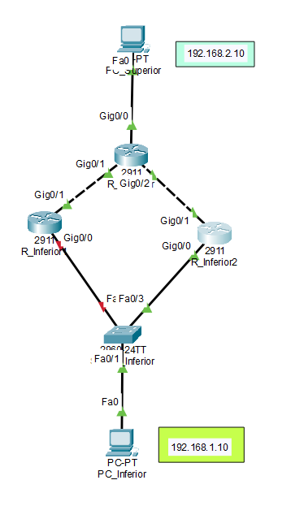

## 2. Configuración IP de los Dispositivos Finales

### 2.1. Configuración IP de PC_Inferior
* **Dirección IP:** `192.168.1.10`
* **Máscara de Subred:** `255.255.255.0`
* **Gateway Predeterminado:** `192.168.1.1` *(Dirección IP Virtual HSRP)*

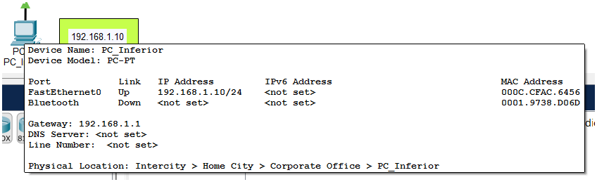

### 2.2. Configuración IP de PC_Superior
* **Dirección IP:** `192.168.2.10`
* **Máscara de Subred:** `255.255.255.0`
* **Gateway Predeterminado:** `192.168.2.1`

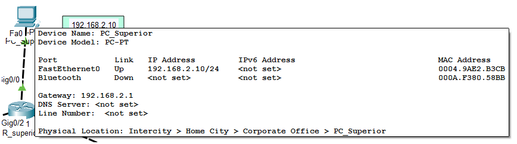

---

## 3. Configuración de HSRP en Routers Inferiores

### 3.1. Configuración HSRP en Router Activo (R_Inferior1)
Se configuró la interfaz `GigabitEthernet0/0` con la dirección IP física `192.168.1.2`, la IP virtual `192.168.1.1`, una prioridad de `110` y la función `preempt` activada.

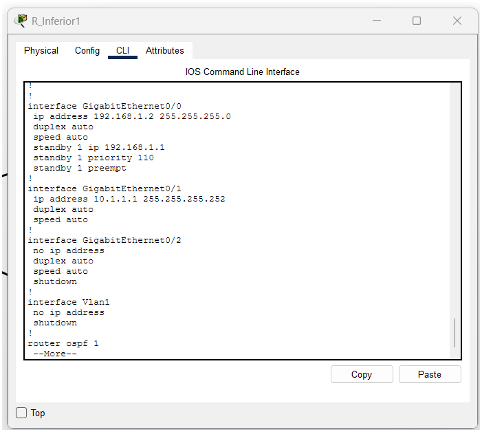

### 3.2. Configuración HSRP en Router Standby (R_Inferior2)
Se configuró la interfaz `GigabitEthernet0/0` con la dirección IP física `192.168.1.3`, la IP virtual `192.168.1.1`, la prioridad por defecto de `100` y la función `preempt` activada.

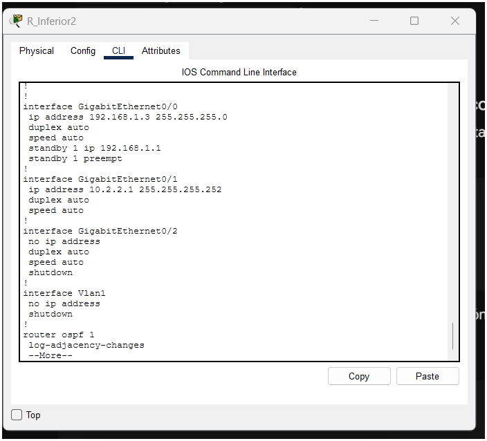

---

## 4. Estado Inicial de HSRP y Conectividad

### 4.1. Verificación del Estado HSRP (`show standby brief`)
Verificación mediante el comando `show standby brief` donde se evidencia a `R_Inferior1` como el router activo y a `R_Inferior2` como el router standby.

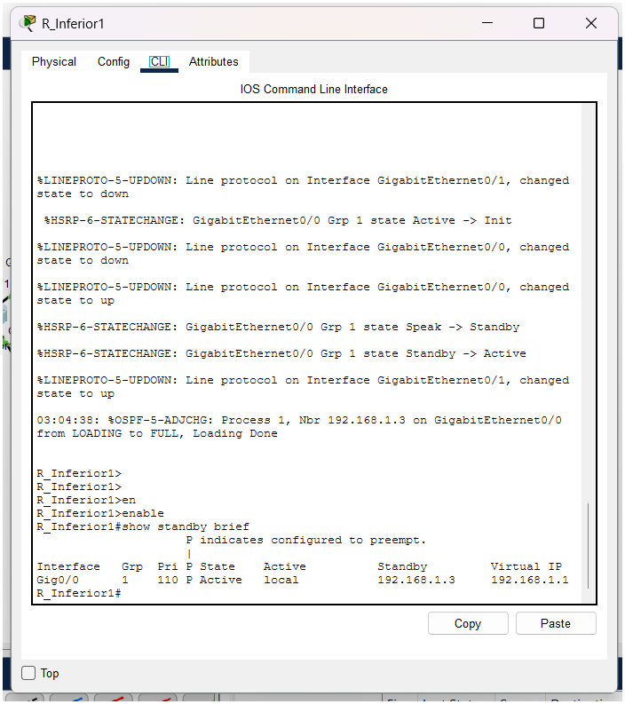
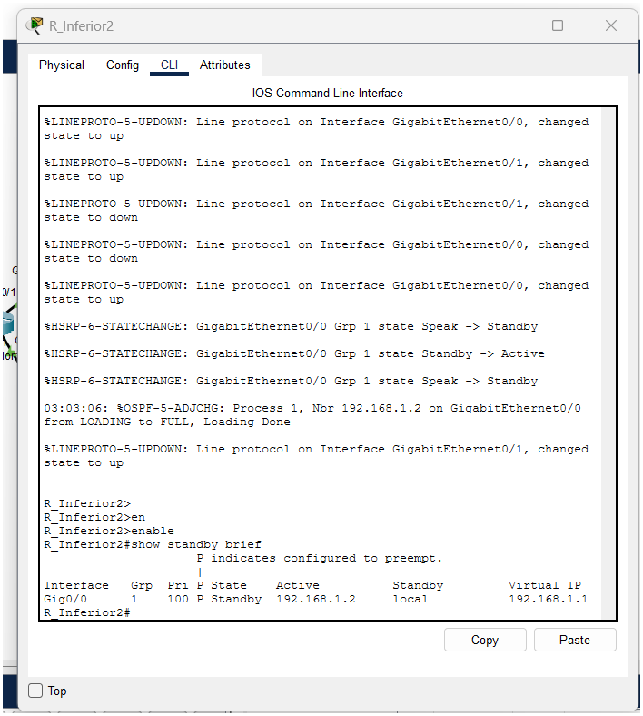

### 4.2. Prueba de Ping Continuo Normal
Prueba de conectividad ejecutando el comando `ping -t 192.168.2.10` desde la `PC_Inferior` hacia la `PC_Superior`, mostrando tráfico fluido y continuo.

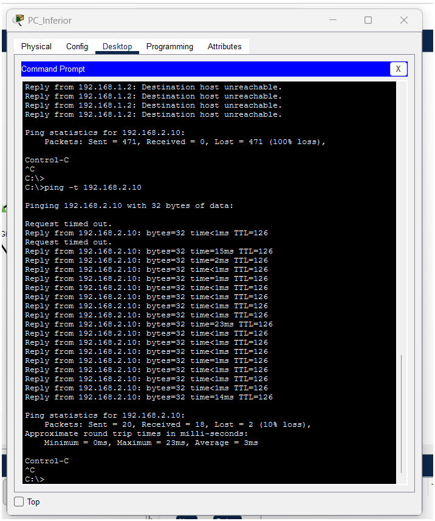

---

## 5. Simulación de Falla y Comportamiento HSRP

### 5.1. Falla Simulada en Router Activo
Se ejecutó el comando `shutdown` en la interfaz `GigabitEthernet0/0` de `R_Inferior1` para simular la caída del router principal de salida.

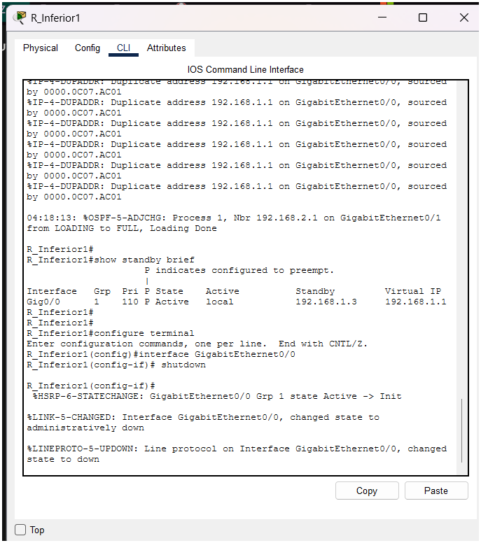

### 5.2. Conmutación a Router Standby
Al detectar la falla, `R_Inferior2` cambió automáticamente su estado de **Standby** a **Active**, asumiendo la responsabilidad del tráfico dirigido hacia la IP virtual `192.168.1.1`.

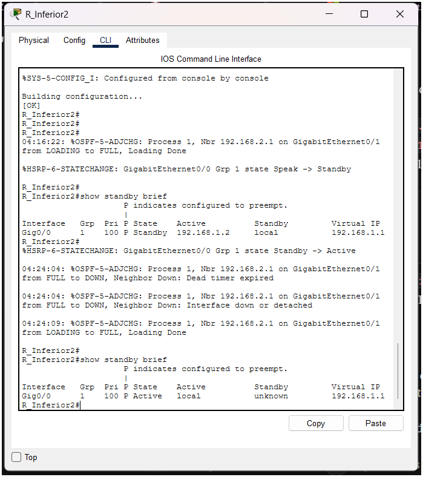

### 5.3. Impacto en el Ping Continuo
En la consola de la `PC_Inferior`, el ping continuo sufrió una interrupción mínima (1 a 2 paquetes perdidos por `Request timed out`) durante la convergencia, recuperando inmediatamente la comunicación a través del gateway de respaldo.

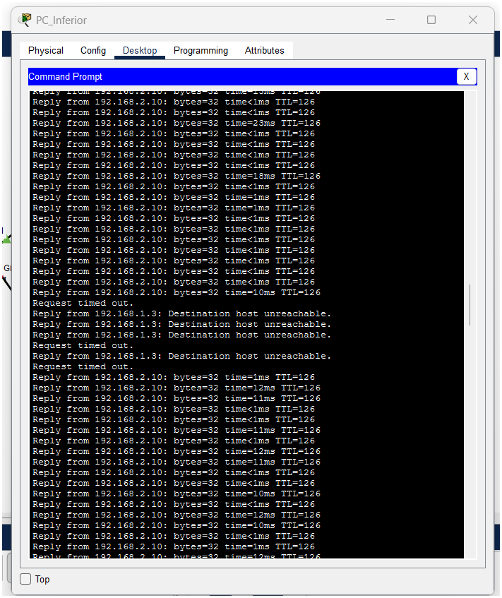

---

## 6. Explicación Técnica

1. **IP Virtual Utilizada como Gateway:**
   Se utilizó la dirección IP `192.168.1.1` como la IP virtual del grupo HSRP 1. Esta dirección actúa como la puerta de enlace predeterminada (Default Gateway) de los hosts de la LAN inferior (`PC_Inferior`), permitiendo que el tráfico de salida no dependa de la IP física de un único dispositivo.

2. **Router que Inició como Activo:**
   `R_Inferior1` inició como el router activo debido a que se le asignó una prioridad HSRP de `110`, la cual es superior a la prioridad por defecto (`100`).

3. **Router que Inició como Standby:**
   `R_Inferior2` inició en el rol de standby al mantener la prioridad por defecto de `100`, quedando a la espera en caso de que el router activo presente una falla.

4. **Comportamiento durante la Falla del Router Activo:**
   Al desactivar la interfaz LAN de `R_Inferior1`, se detuvo el envío de mensajes *Hello* de HSRP. Transcurrido el tiempo límite de espera (*hold time*), `R_Inferior2` detectó la indisponibilidad del activo y conmutó automáticamente su estado de **Standby** a **Active**, tomando el control de la dirección MAC virtual y de la IP virtual.

5. **Afectación de la Falla al Ping Continuo:**
   La interrupción en el ping fue casi imperceptible. Únicamente se perdieron de 1 a 2 paquetes (*Request timed out*) mientras los routers detectaban la caída y OSPF reconvergía el enlace de salida. La conectividad se restableció en cuestión de pocos segundos de manera transparente para el usuario final.

6. **Función de `preempt` en la Práctica:**
   La instrucción `standby 1 preempt` permite que un router con mayor prioridad reclame y recupere el rol **Active** de forma automática en cuanto vuelva a estar en línea. De esta manera, cuando la interfaz de `R_Inferior1` se reestablece (`no shutdown`), este vuelve a tomar el control del tráfico principal sin intervención manual.