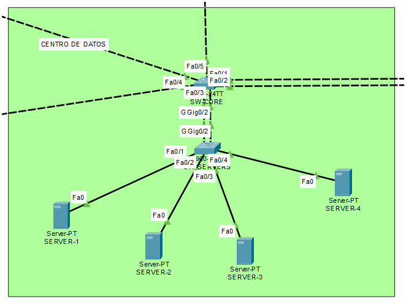
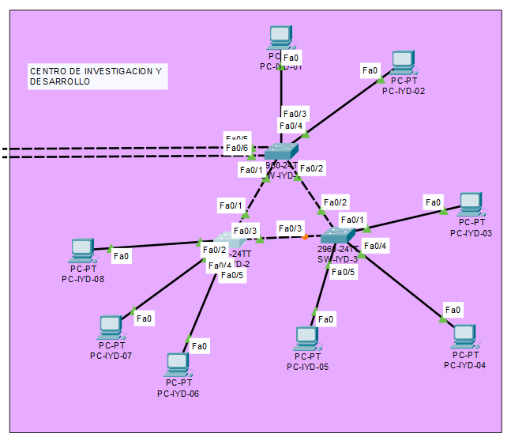
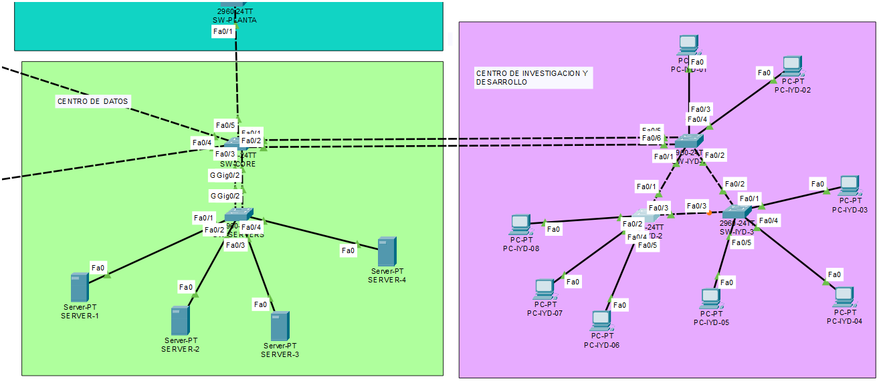
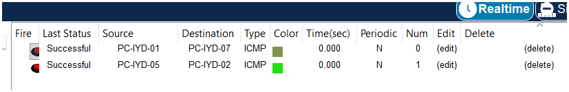
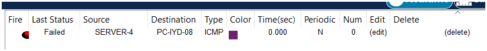
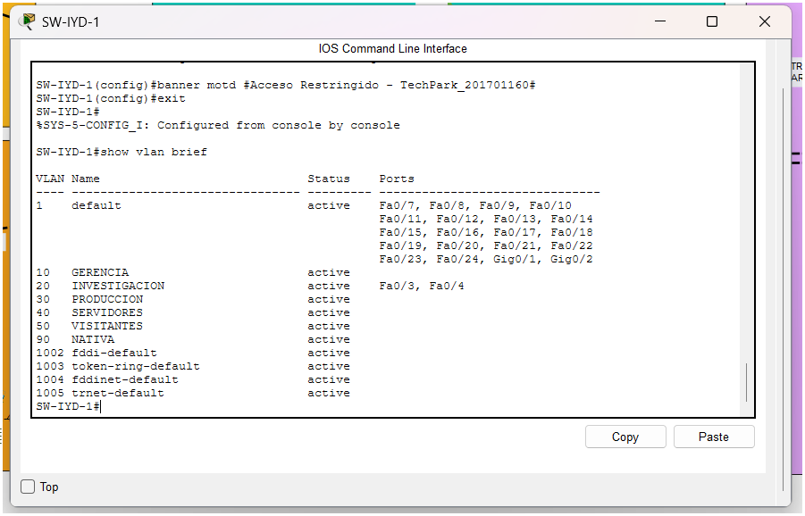
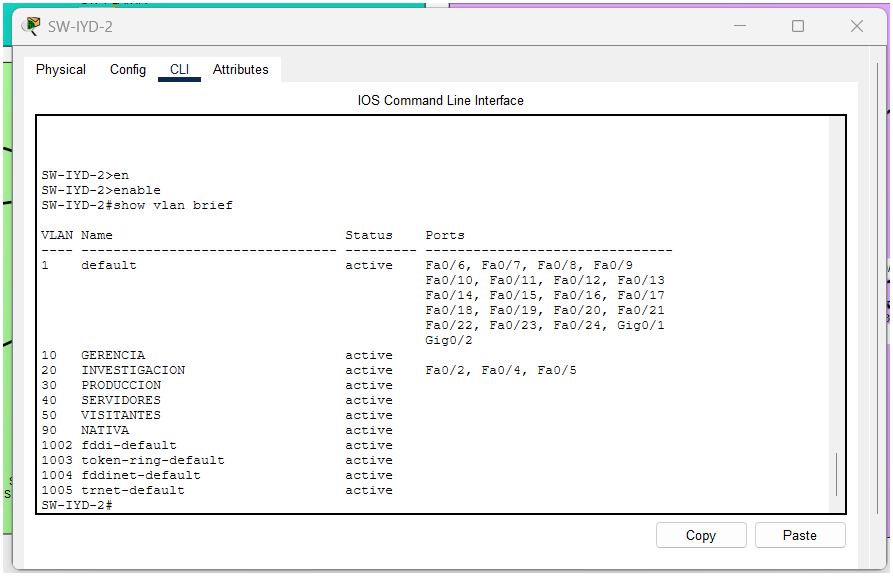
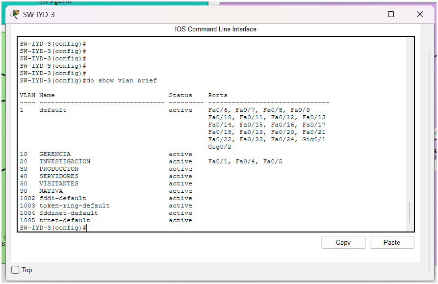
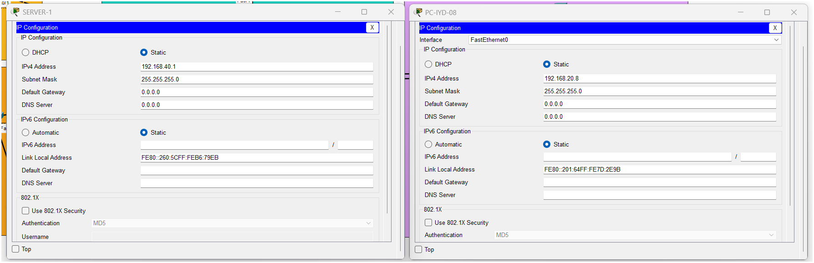
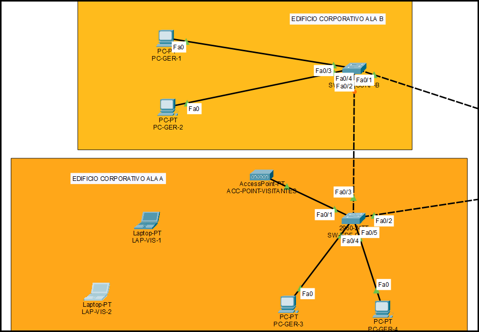

## 4. Diseño e Implementación de la Topología

### 4.1 Centro de Datos (Core)

**Dispositivos utilizados:**
- 1x Switch Cisco 2960-24TT — `SW-CORE` (Núcleo de la red, VTP Server)
- 1x Switch Cisco 2960-24TT — `SW-SERVERS`
- 4x Servidor genérico — `SERVER-1` a `SERVER-4`

**Conexiones físicas:**

| Origen | Puerto | Destino | Puerto | Tipo de cable | Justificación |
|---|---|---|---|---|---|
| SRV-01..04 | FastEthernet0 | SW-SERVERS | Fa0/1–0/4 | Cobre directo (Straight-through) | Conexión switch-dispositivo final |
| SW-SERVERS | Gi0/1 | SW-CORE | Gi0/1 | Cobre cruzado (Crossover) | Enlace 1 de EtherChannel hacia el Core |
| SW-SERVERS | Gi0/2 | SW-CORE | Gi0/2 | Cobre cruzado (Crossover) | Enlace 2 de EtherChannel hacia el Core |

Se utilizaron 2 enlaces físicos independientes entre `SW-SERVERS` y `SW-CORE` para garantizar que el acceso a la granja de servidores críticos no dependa de una única conexión física, como lo exige el enunciado. Estos enlaces se agregarán lógicamente mediante EtherChannel (LACP) en la fase de configuración lógica.

**Configuración VTP y VLANs (aplicada en SW-CORE):**

```
enable
configure terminal
hostname SW-CORE

vlan 10
name GERENCIA
vlan 20
name INVESTIGACION
vlan 30
name PRODUCCION
vlan 40
name SERVIDORES
vlan 50
name VISITANTES
vlan 90
name NATIVA

vtp domain Smart_6
vtp password proyecto12S2026
vtp mode server
vtp version 2
```


`SW-CORE` se configuró como **VTP Server**, ya que actúa como el núcleo administrativo del dominio `Smart_6` y es el único switch donde deben crearse las VLANs; estas se propagarán automáticamente hacia los switches clientes del resto del campus.



---

### 4.2 Centro de I+D (Investigación y Desarrollo)

**Dispositivos utilizados:**
- 3x Switch Cisco 2960-24TT — `SW-IYD-1`, `SW-IYD-2`, `SW-IYD-3`
- 8x PC genérica — distribuidas entre los 3 switches

**Conexiones físicas:**

| Origen | Puerto | Destino | Puerto | Tipo de cable | Justificación |
|---|---|---|---|---|---|
| SW-IYD-1 | Fa0/1 | SW-IYD-2 | Fa0/1 | Cobre cruzado | Enlace de alta disponibilidad (triángulo) |
| SW-IYD-1 | Fa0/2 | SW-IYD-3 | Fa0/2 | Cobre cruzado | Enlace de alta disponibilidad (triángulo) |
| SW-IYD-2 | Fa0/2 | SW-IYD-3 | Fa0/2 | Cobre cruzado | Enlace de alta disponibilidad (triángulo) |
| SW-IYD-1 | Fa0/3 | SW-CORE | Fa0/1 | Cobre cruzado | Enlace 1 de EtherChannel hacia el Core |
| SW-IYD-1 | Fa0/4 | SW-CORE | Fa0/2 | Cobre cruzado | Enlace 2 de EtherChannel hacia el Core |
| PC1..PC8 | FastEthernet | SW-IYD-1/2/3 | Fa0/x | Cobre directo | Conexión switch-dispositivo final |

Los 3 switches de este centro se interconectaron formando un **triángulo** (malla parcial), de modo que la caída de cualquiera de ellos no aísla a los demás — la conectividad se mantiene a través del enlace restante. Al existir múltiples caminos redundantes entre los switches, esta topología genera un bucle de Capa 2, por lo que se requiere Spanning Tree Protocol (PVST, según el criterio de asignación por número de carnet) para prevenir tormentas de broadcast.

El enlace hacia `SW-CORE` se estableció mediante 2 conexiones físicas independientes (`SW-IYD-1` Fa0/3 y Fa0/4), pensadas para agregarse como EtherChannel y así proveer mayor capacidad de ancho de banda que el resto de los enlaces troncales del campus.

- **Topologia del Centro de Investigacion y Desarrollo**


- **Union del Centro de Investigacion y Desarrollo y Centro de datos**



### 4.2.1 Configuración de Trunk y VTP — Centro de I+D

**Enlaces troncales entre los 3 switches (triángulo redundante):**

| Switch A | Puerto | Switch B | Puerto |
|---|---|---|---|
| SW-IYD-1 | Fa0/1 | SW-IYD-2 | Fa0/1 |
| SW-IYD-1 | Fa0/2 | SW-IYD-3 | Fa0/2 |
| SW-IYD-2 | Fa0/3 | SW-IYD-3 | Fa0/3 |

**Configuración aplicada en SW-IYD-1:**

```
enable
configure terminal
hostname SW-IYD-1
no ip domain-lookup

interface FastEthernet0/1
switchport mode trunk
switchport trunk native vlan 90
exit

interface FastEthernet0/2
switchport mode trunk
switchport trunk native vlan 90
exit

vtp domain Smart_6
vtp password proyecto12S2026
vtp mode client
```


**Configuración aplicada en SW-IYD-2:**

```
enable
configure terminal
hostname SW-IYD-2
no ip domain-lookup

interface FastEthernet0/1
switchport mode trunk
switchport trunk native vlan 90
exit

interface FastEthernet0/3
switchport mode trunk
switchport trunk native vlan 90
exit

vtp domain Smart_6
vtp password proyecto12S2026
vtp mode client
```

**Configuración aplicada en SW-IYD-3:**
```
enable
configure terminal
hostname SW-IYD-3
no ip domain-lookup

interface FastEthernet0/2
switchport mode trunk
switchport trunk native vlan 90
exit

interface FastEthernet0/3
switchport mode trunk
switchport trunk native vlan 90
exit

vtp domain Smart_6
vtp password proyecto12S2026
vtp mode client
```

**Configuración VTP Client en SW-SERVERS:**
```
enable
configure terminal
hostname SW-SERVERS
no ip domain-lookup

vtp domain Smart_6
vtp password proyecto12S2026
vtp mode client
```

Los switches `SW-SERVERS`, `SW-IYD-1`, `SW-IYD-2` y `SW-IYD-3` se configuraron en modo **VTP Client**, de forma que reciben automáticamente las VLANs creadas en `SW-CORE` (VTP Server) sin necesidad de crearlas manualmente en cada uno, cumpliendo con el modelo de administración centralizada exigido por el enunciado.

Al interconectar `SW-IYD-1`, `SW-IYD-2` y `SW-IYD-3` en topología de triángulo, se generó un bucle físico de Capa 2. **Spanning Tree Protocol (PVST)** detectó automáticamente la redundancia y colocó uno de los tres enlaces en estado **Blocking**, evitando así tormentas de broadcast mientras se mantiene la alta disponibilidad: si cualquiera de los otros dos enlaces falla, STP reconverge y habilita el enlace bloqueado.


### 4.2.2 Asignación de VLANs de Acceso y Direccionamiento IP

**Centro de Datos — VLAN 40 (SERVIDORES) en SW-SERVERS:**
```
interface range FastEthernet0/1-4
switchport mode access
switchport access vlan 40
```

| Dispositivo | Switch | Puerto | VLAN | IP | Máscara |
|---|---|---|---|---|---|
| SERVER-1 | SW-SERVERS | Fa0/1 | 40 | 192.168.40.1 | 255.255.255.0 |
| SERVER-2 | SW-SERVERS | Fa0/2 | 40 | 192.168.40.2 | 255.255.255.0 |
| SERVER-3 | SW-SERVERS | Fa0/3 | 40 | 192.168.40.3 | 255.255.255.0 |
| SERVER-4 | SW-SERVERS | Fa0/4 | 40 | 192.168.40.4 | 255.255.255.0 |

**Centro de I+D — VLAN 20 (INVESTIGACION) en SW-IYD-1/2/3:**

- SW-IYD-1

```
interface range FastEthernet0/3-4
switchport mode access
switchport access vlan 20
```

- SW-IYD-2
```
interface FastEthernet0/2
switchport mode access
switchport access vlan 20
interface FastEthernet0/4
switchport mode access
switchport access vlan 20
interface FastEthernet0/5
switchport mode access
switchport access vlan 20
```

- SW-IYD-3
```
interface FastEthernet0/1
switchport mode access
switchport access vlan 20
interface FastEthernet0/4
switchport mode access
switchport access vlan 20
interface FastEthernet0/5
switchport mode access
switchport access vlan 20
```


| Dispositivo | Switch | Puerto | VLAN | IP | Máscara |
|---|---|---|---|---|---|
| PC-IYD-01 | SW-IYD-1 | Fa0/3 | 20 | 192.168.20.1 | 255.255.255.0 |
| PC-IYD-02 | SW-IYD-1 | Fa0/4 | 20 | 192.168.20.2 | 255.255.255.0 |
| PC-IYD-03 | SW-IYD-2 | Fa0/2 | 20 | 192.168.20.3 | 255.255.255.0 |
| PC-IYD-04 | SW-IYD-2 | Fa0/4 | 20 | 192.168.20.4 | 255.255.255.0 |
| PC-IYD-05 | SW-IYD-2 | Fa0/5 | 20 | 192.168.20.5 | 255.255.255.0 |
| PC-IYD-06 | SW-IYD-3 | Fa0/1 | 20 | 192.168.20.6 | 255.255.255.0 |
| PC-IYD-07 | SW-IYD-3 | Fa0/4 | 20 | 192.168.20.7 | 255.255.255.0 |
| PC-IYD-08 | SW-IYD-3 | Fa0/5 | 20 | 192.168.20.8 | 255.255.255.0 |

**Pruebas de conectividad realizadas:**
- Ping exitoso entre dispositivos dentro de la misma VLAN, confirmando que el trunk y VTP propagan correctamente el tráfico etiquetado a través del triángulo redundante.

- Ping exitoso entre misma Vlan


- Ping fallido por diferentes Vlans



- Show vlan brief SW-IYD-1

- Show vlan brief SW-IYD-2

- Show vlan brief SW-IYD-3


- Configuracion IP



### 4.3 Edificio Corporativo

**Dispositivos utilizados:**
- 2x Switch Cisco 2960-24TT — `SW-EDF-CORP-A` (Ala 1), `SW-EDF-CORP-B` (Ala 2)
- 1x Access Point genérico (AP-PT) — `ACC-POINT-VISITANTES`
- 4x PC — `PC-GER-1` a `PC-GER-4` (2 por ala, personal administrativo)
- 2x Laptop — `LAP-VIS-1`, `LAP-VIS-2` (invitados, conexión inalámbrica)

**Conexiones físicas:**

| Origen | Puerto | Destino | Puerto | Tipo de cable |
|---|---|---|---|---|
| SW-CORE | Fa0/3 | SW-EDF-CORP-A | Fa0/2 | Cobre cruzado |
| SW-CORE | Fa0/4 | SW-EDF-CORP-B | Fa0/1 | Cobre cruzado |
| SW-EDF-CORP-A | Fa0/3 | SW-EDF-CORP-B | Fa0/2 | Cobre cruzado |
| SW-EDF-CORP-A | Fa0/1 | ACC-POINT-VISITANTES | — | Cobre directo |
| SW-EDF-CORP-A | Fa0/4 | PC-GER-3 | Fa0 | Cobre directo |
| SW-EDF-CORP-A | Fa0/5 | PC-GER-4 | Fa0 | Cobre directo |
| SW-EDF-CORP-B | Fa0/3 | PC-GER-1 | Fa0 | Cobre directo |
| SW-EDF-CORP-B | Fa0/4 | PC-GER-2 | Fa0 | Cobre directo |

**Justificación del diseño:**

El Edificio Corporativo se distribuye físicamente en dos ubicaciones (alas), cada una con su propio switch de acceso (`SW-EDF-CORP-A` y `SW-EDF-CORP-B`), ambos conectados de forma independiente hacia `SW-CORE`. Para garantizar que la conectividad entre ambas alas se mantenga activa aunque la ruta hacia el Core quede inhabilitada, se añadió un enlace directo entre `SW-EDF-CORP-A` y `SW-EDF-CORP-B`, formando una topología en triángulo (Core–A, Core–B, A–B).

A diferencia del Centro de Datos y el Centro de I+D, en este edificio no se implementó EtherChannel, ya que el enunciado no exige concentración adicional de ancho de banda en estos enlaces específicos, sino continuidad de conectividad ante fallos de ruta. Esta redundancia se resuelve mediante la topología triangular en conjunto con Spanning Tree Protocol (PVST), el cual detecta el bucle generado por los tres enlaces y bloquea automáticamente uno de ellos para prevenir tormentas de broadcast, sin perder la capacidad de reconvergencia ante una falla.

El Access Point se conectó a `SW-EDF-CORP-A` para brindar servicio inalámbrico a las laptops de los visitantes (VLAN 50 - VISITANTES), manteniendo el tráfico de invitados completamente aislado del tráfico administrativo (VLAN 10 - GERENCIA) mediante segmentación lógica por VLAN.




### 4.3.1 Configuración de Trunk y VTP — Edificio Corporativo

**Configuración aplicada en SW-CORE (puertos hacia Corporativo):**

```interface FastEthernet0/3
switchport mode trunk
switchport trunk native vlan 90
exit

interface FastEthernet0/4
switchport mode trunk
switchport trunk native vlan 90
exit
```


**Configuración aplicada en SW-EDF-CORP-A:**

```
hostname SW-EDF-CORP-A
no ip domain-lookup

interface FastEthernet0/2
switchport mode trunk
switchport trunk native vlan 90
exit

interface FastEthernet0/3
switchport mode trunk
switchport trunk native vlan 90
exit

vtp domain Smart_6
vtp password proyecto12S2026
vtp mode client
```


**Configuración aplicada en SW-EDF-CORP-B:**
```
hostname SW-EDF-CORP-B
no ip domain-lookup

interface FastEthernet0/1
switchport mode trunk
switchport trunk native vlan 90
exit

interface FastEthernet0/2
switchport mode trunk
switchport trunk native vlan 90
exit

vtp domain Smart_6
vtp password proyecto12S2026
vtp mode client
```

Al interconectar `SW-CORE`, `SW-EDF-CORP-A` y `SW-EDF-CORP-B` en topología triangular, se generó nuevamente un bucle de Capa 2. **Spanning Tree Protocol (PVST)** bloqueó automáticamente uno de los tres enlaces para prevenir tormentas de broadcast, garantizando que la conectividad entre alas se mantenga activa ante la falla de cualquiera de los otros dos enlaces.

[CAPTURA AQUÍ: show vlan brief en SW-EDF-CORP-A y SW-EDF-CORP-B mostrando VLANs propagadas]

---

### 4.3.2 Asignación de VLANs de Acceso — Gerencia (VLAN 10)
```
! SW-EDF-CORP-A (PC-GER-3, PC-GER-4)
interface range FastEthernet0/4-5
switchport mode access
switchport access vlan 10

! SW-EDF-CORP-B (PC-GER-1, PC-GER-2)
interface range FastEthernet0/3-4
switchport mode access
switchport access vlan 10
```

| Dispositivo | Switch | Puerto | VLAN | IP | Máscara |
|---|---|---|---|---|---|
| PC-GER-1 | SW-EDF-CORP-B | Fa0/3 | 10 | 192.168.10.1 | 255.255.255.0 |
| PC-GER-2 | SW-EDF-CORP-B | Fa0/4 | 10 | 192.168.10.2 | 255.255.255.0 |
| PC-GER-3 | SW-EDF-CORP-A | Fa0/4 | 10 | 192.168.10.3 | 255.255.255.0 |
| PC-GER-4 | SW-EDF-CORP-A | Fa0/5 | 10 | 192.168.10.4 | 255.255.255.0 |

**Prueba de conectividad:** ping exitoso entre PCs de ambas alas dentro de la misma VLAN 10 (ej. PC-GER-1 ↔ PC-GER-3), confirmando conectividad a través del trunk entre switches físicamente distintos.

[CAPTURA AQUÍ: ping exitoso entre PC-GER-1 y PC-GER-3]

---

### 4.3.3 Configuración del Access Point y Segmento de Visitantes (VLAN 50)

**Puerto de acceso para el AP, en SW-EDF-CORP-A:**
```
interface FastEthernet0/1
switchport mode access
switchport access vlan 50
exit
```

**Configuración inalámbrica en ACC-POINT-VISITANTES:**

| Parámetro | Valor |
|---|---|
| SSID | Visitantes_TechPark |
| Autenticación | WPA2-PSK |
| Contraseña | TechPark2026 |

[CAPTURA AQUÍ: configuración Port 1 (802.11) del Access Point]

**Preparación de los clientes inalámbricos (laptops):**

Las laptops `LAP-VIS-1` y `LAP-VIS-2` requirieron la instalación manual del módulo inalámbrico **WPC300N** en su ranura física (apagando el equipo antes de insertarlo), ya que no venía integrado por defecto.

[CAPTURA AQUÍ: pestaña Physical de LAP-VIS-1 mostrando el módulo WPC300N instalado]

Posteriormente, desde **Desktop → PC Wireless → Connect**, cada laptop se asoció manualmente a la red `Visitantes_TechPark` ingresando la contraseña correspondiente.

[CAPTURA AQUÍ: pestaña Connect de PC Wireless con el SSID Visitantes_TechPark asociado]

Finalmente, se asignó direccionamiento IP **estático** (no DHCP) a cada laptop, dentro del rango correspondiente a la VLAN 50:

| Dispositivo | IP | Máscara |
|---|---|---|
| LAP-VIS-1 | 192.168.50.1 | 255.255.255.0 |
| LAP-VIS-2 | 192.168.50.2 | 255.255.255.0 |

[CAPTURA AQUÍ: IP Configuration en modo Static de LAP-VIS-1]

**Pruebas de conectividad y aislamiento:**

- Ping exitoso entre `LAP-VIS-1` (192.168.50.1) y `LAP-VIS-2` (192.168.50.2), confirmando conectividad inalámbrica dentro de la VLAN 50.
- Ping fallido desde `LAP-VIS-1` hacia una PC de Gerencia (ej. 192.168.10.1), confirmando el aislamiento inter-VLAN entre el tráfico de invitados y el tráfico administrativo, tal como lo exige el enunciado.

[CAPTURA AQUÍ: ping exitoso LAP-VIS-1 → LAP-VIS-2]
[CAPTURA AQUÍ: ping fallido (Request timed out) LAP-VIS-1 → PC-GER-1]


### 4.4 Planta de Producción

**Dispositivos utilizados:**
- 1x Switch Cisco 2960-24TT — `SW-PLANTA`
- 1x Hub genérico (Hub-PT) — `HUB-LEGACY`
- 3x PC — `PC-LEGACY-1`, `PC-LEGACY-2`, `PC-LEGACY-3` (maquinaria industrial simulada)

**Conexiones físicas:**

| Origen | Puerto | Destino | Puerto | Tipo de cable |
|---|---|---|---|---|
| SW-CORE | Fa0/5 | SW-PLANTA | Fa0/1 | Cobre cruzado |
| SW-PLANTA | Fa0/2 | HUB-LEGACY | Fa0 | Cobre cruzado |
| HUB-LEGACY | Fa1 | PC-LEGACY-1 | Fa0 | Cobre directo |
| HUB-LEGACY | Fa2 | PC-LEGACY-2 | Fa0 | Cobre directo |
| HUB-LEGACY | Fa3 | PC-LEGACY-3 | Fa0 | Cobre directo |

**Configuración aplicada en SW-CORE (puerto hacia Planta):**

```
interface FastEthernet0/5
switchport mode trunk
switchport trunk native vlan 90
exit
```


**Configuración aplicada en SW-PLANTA:**

```
hostname SW-PLANTA
no ip domain-lookup

interface FastEthernet0/1
switchport mode trunk
switchport trunk native vlan 90
exit

interface FastEthernet0/2
switchport mode access
switchport access vlan 30
exit

vtp domain Smart_6
vtp password proyecto12S2026
vtp mode client
```


**Direccionamiento IP:**

| Dispositivo | VLAN | IP | Máscara |
|---|---|---|---|
| PC-LEGACY-1 | 30 | 192.168.30.1 | 255.255.255.0 |
| PC-LEGACY-2 | 30 | 192.168.30.2 | 255.255.255.0 |
| PC-LEGACY-3 | 30 | 192.168.30.3 | 255.255.255.0 |

**Prueba de conectividad:** ping exitoso entre las 3 PCs legacy, confirmando comunicación dentro del segmento compartido y a través de la VLAN 30 hacia el resto del dominio VTP.

[CAPTURA AQUÍ: show vlan brief en SW-PLANTA]
[CAPTURA AQUÍ: ping exitoso entre PC-LEGACY-1 y PC-LEGACY-3]
[CAPTURA AQUÍ: topología de la Planta de Producción en Packet Tracer]

---

#### 4.4.1 Análisis del dominio de colisión compartido (segmento Legacy)

El Hub opera en la Capa 1 del modelo OSI y **no realiza ninguna segmentación del tráfico**: simplemente repite eléctricamente cada trama recibida hacia todos sus demás puertos activos, sin importar el destino. Como consecuencia, `PC-LEGACY-1`, `PC-LEGACY-2`, `PC-LEGACY-3` y el puerto Fa0/2 de `SW-PLANTA` **comparten un único dominio de colisión**, a diferencia de cualquier otro segmento de la topología, donde cada puerto de switch constituye su propio dominio de colisión individual.

**Impacto sobre el rendimiento de la red:**

- Solo un dispositivo del segmento puede transmitir a la vez; si dos o más transmiten simultáneamente, ocurre una **colisión**, obligando a ambos emisores a esperar un tiempo aleatorio (backoff) antes de reintentar.
- El Hub opera en **half-duplex** obligatorio, ya que no puede coordinar transmisión y recepción simultánea entre múltiples puertos.
- A medida que se agregan más dispositivos legacy a este segmento, la probabilidad de colisión y el tiempo de espera promedio aumentan, degradando el rendimiento proporcionalmente al número de equipos conectados.
- Este comportamiento contrasta con el resto del campus, donde los switches (conmutación por hardware, dominios de colisión independientes por puerto, full-duplex) no sufren este problema.

**Medidas de contención aplicadas (a nivel del switch de acceso `SW-PLANTA`):**

Dado que no es posible eliminar el Hub sin sustituir la maquinaria legacy (fuera del alcance de este proyecto), las medidas de mitigación se aplican en el punto de unión entre el mundo legacy y el mundo conmutado:

1. **Aislamiento mediante VLAN dedicada (VLAN 30 - PRODUCCION):** aunque no elimina las colisiones dentro del segmento Legacy, contiene el dominio de broadcast generado por ese segmento, evitando que el tráfico de difusión del Hub se propague hacia el resto del campus (Gerencia, Investigación, Servidores, Visitantes).
2. **Concentración del segmento en un único puerto de acceso del switch (Fa0/2):** el switch trata a todo el segmento Legacy como un solo dominio de colisión aislado del resto de sus puertos, evitando que la ineficiencia del Hub afecte el rendimiento de otros segmentos conectados al mismo switch.
3. **Enlace troncal dedicado hacia el Core:** el tráfico legítimo que logra salir del segmento Legacy circula por un enlace independiente (Fa0/1 trunk), sin competir por ancho de banda con otros segmentos del campus en el mismo cable.

Estas medidas mitigan el impacto del dominio de colisión compartido sin eliminarlo, tal como lo exige el enunciado — la única forma de eliminarlo por completo sería reemplazar el Hub por un switch, lo cual no es viable mientras la maquinaria industrial opere con protocolos legacy incompatibles con conmutación moderna.

### 8.2 Selección de Root Bridge (STP - PVST)

Se configuró manualmente la prioridad de Spanning Tree para establecer switches Root Bridge estratégicos en cada uno de los dos triángulos redundantes del campus, en lugar de dejar la elección por default (que depende únicamente de la MAC address más baja).

| VLAN | Root Bridge asignado | Prioridad | Justificación |
|---|---|---|---|
| 10 (Gerencia) | SW-CORE | 4096 | Punto de salida obligatorio del triángulo Corporativo hacia el resto del campus |
| 50 (Visitantes) | SW-CORE | 4096 | Mismo triángulo que Gerencia |
| 20 (Investigación) | SW-IYD-1 | 4096 | Switch de distribución de I+D, único con salida hacia el Core |
| 30 (Producción) | SW-CORE | 4096 | Backbone central del campus (sin bucle real en esta área) |
| 40 (Servidores) | SW-CORE | 4096 | Backbone central del campus (sin bucle real en esta área) |
| 90 (Nativa) | SW-CORE | 4096 | Punto más central de todo el campus |

**Resultado verificado con `show spanning-tree`:**

En el triángulo Corporativo (VLAN 10), con `SW-CORE` como root, el puerto Fa0/2 de `SW-EDF-CORP-B` (enlace directo hacia `SW-EDF-CORP-A`) quedó en estado **Blocking (Altn)**, mientras que ambas alas mantienen su ruta directa hacia el Core en estado Forwarding. Esto confirma que, ante una falla del enlace Core↔A o Core↔B, STP reconvergerá utilizando el enlace A↔B, cumpliendo el requisito de alta disponibilidad entre alas.

En el triángulo de I+D (VLAN 20), con `SW-IYD-1` como root, el puerto Fa0/3 de `SW-IYD-3` (enlace directo hacia `SW-IYD-2`) quedó en estado **Blocking (Altn)**, mientras que ambos switches de hoja mantienen su ruta directa hacia `SW-IYD-1` en Forwarding. Esto confirma que la caída de cualquiera de los tres switches no aísla a los demás, ya que existe siempre un camino alternativo disponible.

[CAPTURA AQUÍ: show spanning-tree vlan 10 en SW-CORE, SW-EDF-CORP-A, SW-EDF-CORP-B]
[CAPTURA AQUÍ: show spanning-tree vlan 20 en SW-IYD-1, SW-IYD-2, SW-IYD-3]

### 8.3 Seguridad Básica — Banner MOTD

Se configuró un banner de tipo **MOTD (Message Of The Day)** en todos los switches de distribución del campus, con el propósito de advertir formalmente sobre el acceso restringido al dispositivo antes de cualquier intento de autenticación. Esta es una práctica estándar de seguridad perimetral en entornos de red empresarial.

**Comando aplicado:**

```
banner motd #Acceso Restringido - TechPark_201701160#
```


**Switches considerados "de distribución"** (aquellos que constituyen el único punto de entrada/salida hacia el Core desde su respectiva área, o que distribuyen tráfico hacia switches de acceso dentro de su propio edificio):

| Switch | Rol de distribución |
|---|---|
| SW-CORE | Núcleo del campus, distribuye hacia las 3 áreas restantes |
| SW-IYD-1 | Único enlace de I+D hacia el Core |
| SW-EDF-CORP-A | Distribuye hacia su ala y conecta directo al Core |
| SW-EDF-CORP-B | Distribuye hacia su ala y conecta directo al Core |
| SW-PLANTA | Único enlace de Planta de Producción hacia el Core |

No se aplicó en `SW-SERVERS`, `SW-IYD-2` ni `SW-IYD-3`, al ser switches de acceso puro (no distribuyen tráfico hacia otros switches ni constituyen un punto único de conexión hacia el Core).

[CAPTURA AQUÍ: banner MOTD visible al reconectar la sesión de consola en SW-CORE]

### 4.5 Dominios de Colisión y Dominios de Broadcast

#### 4.5.1 Dominios de Colisión (por switch, según puertos activos)

| Switch | Puertos activos | Dominios de colisión generados | Detalle |
|---|---|---|---|
| SW-CORE | Gi0/1, Gi0/2, Fa0/1, Fa0/2, Fa0/3, Fa0/4, Fa0/5 | 7 | Uno por cada puerto (full-duplex, punto a punto) |
| SW-SERVERS | Fa0/1-4, Gi0/1, Gi0/2 | 6 | Uno por cada puerto |
| SW-IYD-1 | Fa0/1-6 | 6 | Uno por cada puerto |
| SW-IYD-2 | Fa0/1-5 | 5 | Uno por cada puerto |
| SW-IYD-3 | Fa0/1-5 | 5 | Uno por cada puerto |
| SW-EDF-CORP-A | Fa0/1-5 | 5 | Uno por cada puerto (incluye el puerto hacia el AP) |
| SW-EDF-CORP-B | Fa0/1-4 | 4 | Uno por cada puerto |
| SW-PLANTA | Fa0/1 | 1 | Puerto normal, hacia SW-CORE (full-duplex) |
| SW-PLANTA (segmento Legacy) | Fa0/2 | **1 dominio de colisión compartido** | Fa0/2 + HUB-LEGACY + PC-LEGACY-1, PC-LEGACY-2, PC-LEGACY-3. Al no haber segmentación de Capa 1 en el Hub, estos 4 elementos (puerto + 3 PCs) **comparten un único dominio de colisión**, a diferencia de cualquier otro segmento de la red |

**Total de dominios de colisión en la red:** 39 (38 individuales por puerto de switch + 1 compartido en el segmento Legacy)

**Nota sobre el segmento inalámbrico (VLAN 50):** el enlace radial entre `ACC-POINT-VISITANTES` y las laptops `LAP-VIS-1`/`LAP-VIS-2` constituye técnicamente un dominio de colisión adicional de tipo half-duplex compartido (medio inalámbrico), independiente del dominio de colisión del puerto Fa0/1 de `SW-EDF-CORP-A` (que conecta al AP por cable).

#### 4.5.2 Dominios de Broadcast (uno por VLAN activa)

| VLAN | Nombre | Dispositivos que lo integran | Switches involucrados |
|---|---|---|---|
| 10 | GERENCIA | PC-GER-1, PC-GER-2, PC-GER-3, PC-GER-4 | SW-EDF-CORP-A, SW-EDF-CORP-B |
| 20 | INVESTIGACION | PC-IYD-01 a PC-IYD-08 | SW-IYD-1, SW-IYD-2, SW-IYD-3 |
| 30 | PRODUCCION | PC-LEGACY-1, PC-LEGACY-2, PC-LEGACY-3 | SW-PLANTA (a través del segmento Legacy) |
| 40 | SERVIDORES | SERVER-1, SERVER-2, SERVER-3, SERVER-4 | SW-SERVERS |
| 50 | VISITANTES | LAP-VIS-1, LAP-VIS-2 (inalámbrico vía ACC-POINT-VISITANTES) | SW-EDF-CORP-A |
| 90 | NATIVA | Sin hosts finales asignados — transporta tráfico no etiquetado entre trunks (control) | Todos los switches del campus |

Cada VLAN constituye un dominio de broadcast **aislado de los demás**, independientemente de que sus dispositivos estén distribuidos en switches físicamente distintos — esto se logra gracias a la segmentación lógica por VLAN y su propagación centralizada mediante VTP, cumpliendo el objetivo de aislamiento inter-VLAN establecido en el resultado del aprendizaje del proyecto.