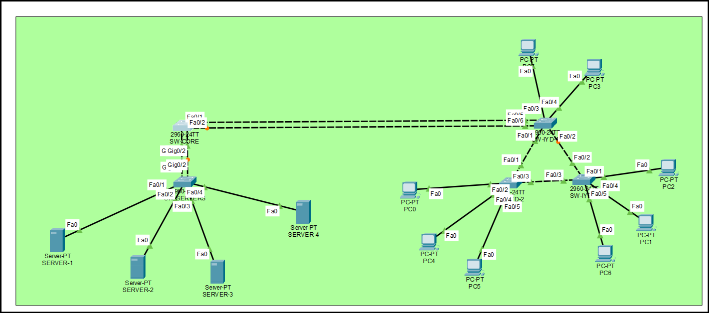
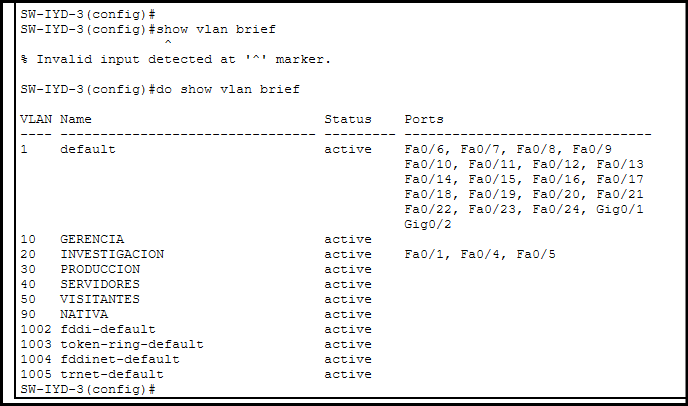

## 4. Diseño e Implementación de la Topología

### 4.1 Centro de Datos (Core)

**Dispositivos utilizados:**
- 1x Switch Cisco 2960-24TT — `SW-CORE` (Núcleo de la red, VTP Server)
- 1x Switch Cisco 2960-24TT — `SW-SERVERS`
- 4x Servidor genérico — `SERVER-1` a `SERVER-4`

**Conexiones físicas:**

| Origen | Puerto | Destino | Puerto | Tipo de cable | Justificación |
|---|---|---|---|---|---|
| SRV-01..04 | FastEthernet0 | SW-SERVERS | Fa0/1–0/4 | Cobre directo (Straight-through) | Conexión switch-dispositivo final |
| SW-SERVERS | Gi0/1 | SW-CORE | Gi0/1 | Cobre cruzado (Crossover) | Enlace 1 de EtherChannel hacia el Core |
| SW-SERVERS | Gi0/2 | SW-CORE | Gi0/2 | Cobre cruzado (Crossover) | Enlace 2 de EtherChannel hacia el Core |

Se utilizaron 2 enlaces físicos independientes entre `SW-SERVERS` y `SW-CORE` para garantizar que el acceso a la granja de servidores críticos no dependa de una única conexión física, como lo exige el enunciado. Estos enlaces se agregarán lógicamente mediante EtherChannel (LACP) en la fase de configuración lógica.

**Configuración VTP y VLANs (aplicada en SW-CORE):**

```
enable
configure terminal
hostname SW-CORE

vlan 10
name GERENCIA
vlan 20
name INVESTIGACION
vlan 30
name PRODUCCION
vlan 40
name SERVIDORES
vlan 50
name VISITANTES
vlan 90
name NATIVA

vtp domain Smart_6
vtp password proyecto12S2026
vtp mode server
vtp version 2
```


`SW-CORE` se configuró como **VTP Server**, ya que actúa como el núcleo administrativo del dominio `Smart_6` y es el único switch donde deben crearse las VLANs; estas se propagarán automáticamente hacia los switches clientes del resto del campus.

[CAPTURA AQUÍ: topología del Centro de Datos en Packet Tracer]

---

### 4.2 Centro de I+D (Investigación y Desarrollo)

**Dispositivos utilizados:**
- 3x Switch Cisco 2960-24TT — `SW-IYD-1`, `SW-IYD-2`, `SW-IYD-3`
- 8x PC genérica — distribuidas entre los 3 switches

**Conexiones físicas:**

| Origen | Puerto | Destino | Puerto | Tipo de cable | Justificación |
|---|---|---|---|---|---|
| SW-IYD-1 | Fa0/1 | SW-IYD-2 | Fa0/1 | Cobre cruzado | Enlace de alta disponibilidad (triángulo) |
| SW-IYD-1 | Fa0/2 | SW-IYD-3 | Fa0/2 | Cobre cruzado | Enlace de alta disponibilidad (triángulo) |
| SW-IYD-2 | Fa0/2 | SW-IYD-3 | Fa0/2 | Cobre cruzado | Enlace de alta disponibilidad (triángulo) |
| SW-IYD-1 | Fa0/3 | SW-CORE | Fa0/1 | Cobre cruzado | Enlace 1 de EtherChannel hacia el Core |
| SW-IYD-1 | Fa0/4 | SW-CORE | Fa0/2 | Cobre cruzado | Enlace 2 de EtherChannel hacia el Core |
| PC1..PC8 | FastEthernet | SW-IYD-1/2/3 | Fa0/x | Cobre directo | Conexión switch-dispositivo final |

Los 3 switches de este centro se interconectaron formando un **triángulo** (malla parcial), de modo que la caída de cualquiera de ellos no aísla a los demás — la conectividad se mantiene a través del enlace restante. Al existir múltiples caminos redundantes entre los switches, esta topología genera un bucle de Capa 2, por lo que se requiere Spanning Tree Protocol (PVST, según el criterio de asignación por número de carnet) para prevenir tormentas de broadcast.

El enlace hacia `SW-CORE` se estableció mediante 2 conexiones físicas independientes (`SW-IYD-1` Fa0/3 y Fa0/4), pensadas para agregarse como EtherChannel y así proveer mayor capacidad de ancho de banda que el resto de los enlaces troncales del campus.



### 4.2.1 Configuración de Trunk y VTP — Centro de I+D

**Enlaces troncales entre los 3 switches (triángulo redundante):**

| Switch A | Puerto | Switch B | Puerto |
|---|---|---|---|
| SW-IYD-1 | Fa0/1 | SW-IYD-2 | Fa0/1 |
| SW-IYD-1 | Fa0/2 | SW-IYD-3 | Fa0/2 |
| SW-IYD-2 | Fa0/3 | SW-IYD-3 | Fa0/3 |

**Configuración aplicada en SW-IYD-1:**

```
enable
configure terminal
hostname SW-IYD-1
no ip domain-lookup

interface FastEthernet0/1
switchport mode trunk
switchport trunk native vlan 90
exit

interface FastEthernet0/2
switchport mode trunk
switchport trunk native vlan 90
exit

vtp domain Smart_6
vtp password proyecto12S2026
vtp mode client
```


**Configuración aplicada en SW-IYD-2:**

```
enable
configure terminal
hostname SW-IYD-2
no ip domain-lookup

interface FastEthernet0/1
switchport mode trunk
switchport trunk native vlan 90
exit

interface FastEthernet0/3
switchport mode trunk
switchport trunk native vlan 90
exit

vtp domain Smart_6
vtp password proyecto12S2026
vtp mode client
```

**Configuración aplicada en SW-IYD-3:**
```
enable
configure terminal
hostname SW-IYD-3
no ip domain-lookup

interface FastEthernet0/2
switchport mode trunk
switchport trunk native vlan 90
exit

interface FastEthernet0/3
switchport mode trunk
switchport trunk native vlan 90
exit

vtp domain Smart_6
vtp password proyecto12S2026
vtp mode client
```

**Configuración VTP Client en SW-SERVERS:**
```
enable
configure terminal
hostname SW-SERVERS
no ip domain-lookup

vtp domain Smart_6
vtp password proyecto12S2026
vtp mode client
```

Los switches `SW-SERVERS`, `SW-IYD-1`, `SW-IYD-2` y `SW-IYD-3` se configuraron en modo **VTP Client**, de forma que reciben automáticamente las VLANs creadas en `SW-CORE` (VTP Server) sin necesidad de crearlas manualmente en cada uno, cumpliendo con el modelo de administración centralizada exigido por el enunciado.

Al interconectar `SW-IYD-1`, `SW-IYD-2` y `SW-IYD-3` en topología de triángulo, se generó un bucle físico de Capa 2. **Spanning Tree Protocol (PVST)** detectó automáticamente la redundancia y colocó uno de los tres enlaces en estado **Blocking**, evitando así tormentas de broadcast mientras se mantiene la alta disponibilidad: si cualquiera de los otros dos enlaces falla, STP reconverge y habilita el enlace bloqueado.



### 4.2.2 Asignación de VLANs de Acceso y Direccionamiento IP

**Centro de Datos — VLAN 40 (SERVIDORES) en SW-SERVERS:**
```
interface range FastEthernet0/1-4
switchport mode access
switchport access vlan 40
```

| Dispositivo | Switch | Puerto | VLAN | IP | Máscara |
|---|---|---|---|---|---|
| SERVER-1 | SW-SERVERS | Fa0/1 | 40 | 192.168.40.1 | 255.255.255.0 |
| SERVER-2 | SW-SERVERS | Fa0/2 | 40 | 192.168.40.2 | 255.255.255.0 |
| SERVER-3 | SW-SERVERS | Fa0/3 | 40 | 192.168.40.3 | 255.255.255.0 |
| SERVER-4 | SW-SERVERS | Fa0/4 | 40 | 192.168.40.4 | 255.255.255.0 |

**Centro de I+D — VLAN 20 (INVESTIGACION) en SW-IYD-1/2/3:**

```
! SW-IYD-1
interface range FastEthernet0/3-4
switchport mode access
switchport access vlan 20

! SW-IYD-2
interface FastEthernet0/2
switchport mode access
switchport access vlan 20
interface FastEthernet0/4
switchport mode access
switchport access vlan 20
interface FastEthernet0/5
switchport mode access
switchport access vlan 20

! SW-IYD-3
interface FastEthernet0/1
switchport mode access
switchport access vlan 20
interface FastEthernet0/4
switchport mode access
switchport access vlan 20
interface FastEthernet0/5
switchport mode access
switchport access vlan 20
```


| Dispositivo | Switch | Puerto | VLAN | IP | Máscara |
|---|---|---|---|---|---|
| PC-IYD-01 | SW-IYD-1 | Fa0/3 | 20 | 192.168.20.1 | 255.255.255.0 |
| PC-IYD-02 | SW-IYD-1 | Fa0/4 | 20 | 192.168.20.2 | 255.255.255.0 |
| PC-IYD-03 | SW-IYD-2 | Fa0/2 | 20 | 192.168.20.3 | 255.255.255.0 |
| PC-IYD-04 | SW-IYD-2 | Fa0/4 | 20 | 192.168.20.4 | 255.255.255.0 |
| PC-IYD-05 | SW-IYD-2 | Fa0/5 | 20 | 192.168.20.5 | 255.255.255.0 |
| PC-IYD-06 | SW-IYD-3 | Fa0/1 | 20 | 192.168.20.6 | 255.255.255.0 |
| PC-IYD-07 | SW-IYD-3 | Fa0/4 | 20 | 192.168.20.7 | 255.255.255.0 |
| PC-IYD-08 | SW-IYD-3 | Fa0/5 | 20 | 192.168.20.8 | 255.255.255.0 |

**Pruebas de conectividad realizadas:**
- Ping exitoso entre dispositivos dentro de la misma VLAN (ej. PC-IYD-01 → PC-IYD-08, ambas en VLAN 20 pero en switches físicos distintos), confirmando que el trunk y VTP propagan correctamente el tráfico etiquetado a través del triángulo redundante.

[CAPTURA AQUÍ: show vlan brief en SW-IYD-1, SW-IYD-2 y SW-IYD-3]
[CAPTURA AQUÍ: ping exitoso entre PC-IYD-01 y PC-IYD-08]
[CAPTURA AQUÍ: IP Configuration de un servidor y una PC como ejemplo]