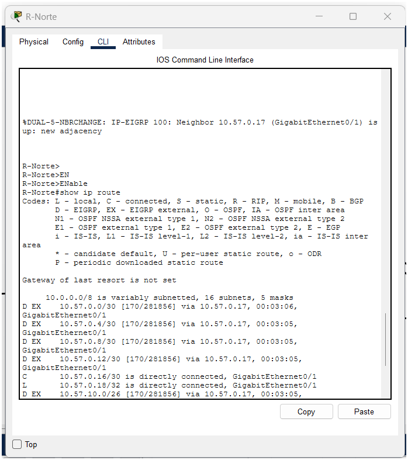
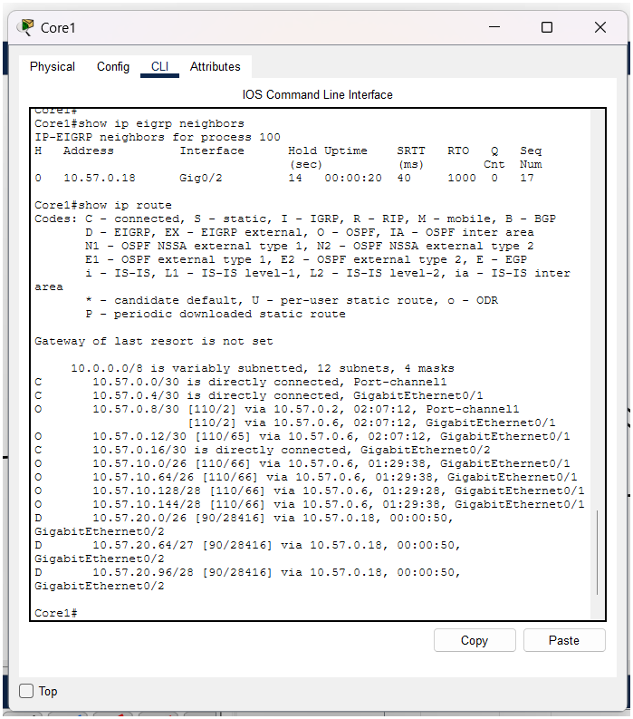

# Grupo 3

**Carnet Coordinador:** 202200057


# Comandos Adicionales

```cisco
no ip domain-lookup
```
# Subnetting VLSM (desde 10.57.10.0/24)

| VLAN | Hosts | Máscara | Red | Gateway |
|------|-------|---------|-----|---------|
| 13 Cajas | 45 | /26 | 10.57.10.0 | .1 |
| 23 Asesores | 30 | /26 | 10.57.10.64 | .65 |
| 43 Seguridad | 12 | /28 | 10.57.10.128 | .129 |
| 33 Gerencia | 10 | /28 | 10.57.10.144 | .145 |


# Configuración Completa de los Routers Core


```cisco
                    ----- CORE 1 ------
enable
configure terminal
hostname Core1
no ip domain-lookup
ip routing
line console 0
 logging synchronous
 exit

interface range fa0/23 - 24
 no channel-group
 shutdown
 exit

interface port-channel 1
 no switchport
 ip address 10.57.0.1 255.255.255.252
 exit

interface range fa0/23 - 24
 no switchport
 channel-group 1 mode on
 no shutdown
 exit

interface gi0/1
 no switchport
 ip address 10.57.0.5 255.255.255.252
 no shutdown
 exit
end
write memory

                    ----- CORE 2 ------
enable
configure terminal
hostname Core2
no ip domain-lookup
ip routing
line console 0
 logging synchronous
 exit

interface range fa0/23 - 24
 no channel-group
 shutdown
 exit


interface port-channel 1
 no switchport
 ip address 10.57.0.2 255.255.255.252
 exit

interface range fa0/23 - 24
 no switchport
 channel-group 1 mode on
 no shutdown
 exit

interface gi0/1
 no switchport
 ip address 10.57.0.9 255.255.255.252
 no shutdown
 exit
end
write memory

                    ----- CORE 3 ------
enable
configure terminal
hostname Core3
no ip domain-lookup
line console 0
 logging synchronous
 exit

interface gi0/0
 ip address 10.57.0.6 255.255.255.252
 no shutdown
 exit

interface gi0/1
 ip address 10.57.0.10 255.255.255.252
 no shutdown
 exit
end
write memory

 ```


# Configuración Enlace Serial: Core 3 ↔ Router Occidente


```cisco
                    ----- En Core 3 -----
configure terminal

interface se0/0/0
 ip address 10.57.0.13 255.255.255.252
 clock rate 64000
 no shutdown
 exit

end
write memory

            ----- En Router occidente -----
enable
configure terminal
hostname R-Occidente
no ip domain-lookup
line console 0
 logging synchronous
 exit

interface se0/0/0
 ip address 10.57.0.14 255.255.255.252
 no shutdown
 exit

end
write memory
```


# Configuración de OSPF


```cisco
                    ---- En Core 1 ----
configure terminal
router ospf 1
 router-id 1.1.1.1
 network 10.57.0.0 0.0.0.3 area 0
 network 10.57.0.4 0.0.0.3 area 0
 exit
end
write memory

                    ---- En Core 2 ----
configure terminal
router ospf 1
 router-id 2.2.2.2
 network 10.57.0.0 0.0.0.3 area 0
 network 10.57.0.8 0.0.0.3 area 0
 exit
end
write memory

                    ---- En Core 3 ----
configure terminal
router ospf 1
 router-id 3.3.3.3
 network 10.57.0.4 0.0.0.3 area 0
 network 10.57.0.8 0.0.0.3 area 0
 network 10.57.0.12 0.0.0.3 area 0
 exit
end
write memory

                    ---- En ROUTER-OCCIDENTE ----
configure terminal
router ospf 1
 router-id 4.4.4.4
 network 10.57.0.12 0.0.0.3 area 0
 exit
end
write memory
```

# Comandos de pruebas
```cisco
show ip ospf neighbor   (Prueba realizada en el Core1.)
show ip route ospf      (Prueba realizada en el Core1.)
```


# Configuración de Switches (Occidente)

```cisco
---- SW-Occ-Principal (VTP server) ----

enable
configure terminal
hostname SW-Occ-Principal
no ip domain-lookup
line console 0
 logging synchronous
 exit

vtp domain bantech57
vtp password cisco
vtp mode server

vlan 13
 name Cajas
vlan 23
 name Asesores
vlan 33
 name Gerencia
vlan 43
 name Seguridad
 exit

interface range fa0/1 - 2
 switchport mode trunk
 exit

interface range fa0/3 - 4
 switchport mode access
 switchport access vlan 13
 exit

interface range fa0/5 - 6
 switchport mode access
 switchport access vlan 23
 exit
end
write memory

        ---- SW-Occ-Acceso (VTP client) ---
enable
configure terminal
hostname SW-Occ-Acceso
no ip domain-lookup
line console 0
 logging synchronous
 exit

vtp domain bantech57
vtp password cisco
vtp mode client

interface fa0/1
 switchport mode trunk
 exit
end
```


# Router-on-a-stick en R-Occidente


```cisco
                    ---- R-Occidente ----
configure terminal

interface gi0/0
 no ip address
 no shutdown
 exit

interface gi0/0.13
 encapsulation dot1Q 13
 ip address 10.57.10.1 255.255.255.192
 exit

interface gi0/0.23
 encapsulation dot1Q 23
 ip address 10.57.10.65 255.255.255.192
 exit

interface gi0/0.33
 encapsulation dot1Q 33
 ip address 10.57.10.145 255.255.255.240
 exit

interface gi0/0.43
 encapsulation dot1Q 43
 ip address 10.57.10.129 255.255.255.240
 exit

router ospf 1
 network 10.57.10.0 0.0.0.255 area 0
 exit
end
write memory

```
# Asignacion de Ip estaticas Occidente
| PC | IP | Máscara | Gateway |
|----|----|---------|---------|
| Cajas 1 | 10.57.10.2 | 255.255.255.192 | 10.57.10.1 |
| Cajas 2 | 10.57.10.3 | 255.255.255.192 | 10.57.10.1 |
| Asesores 1 | 10.57.10.66 | 255.255.255.192 | 10.57.10.65 |
| Asesores 2 | 10.57.10.67 | 255.255.255.192 | 10.57.10.65 |
| Gerencia | 10.57.10.146 | 255.255.255.240 | 10.57.10.145 |
| Seguridad 1 | 10.57.10.130 | 255.255.255.240 | 10.57.10.129 |
| Seguridad 2 | 10.57.10.131 | 255.255.255.240 | 10.57.10.129 |

# Pruebas de ping Occidente
Caja1 - Gateway


Caja1 - Asesores


Caja1 - Gerencia


Caja1 - Core1


# Configuraciones NORTE

## Subnetting y switches de Norte


| VLAN | Hosts + gateway | Máscara | Red | Gateway |
|------|-----------------|---------|-----|---------|
| 53 Análisis | 50 + 1 | /26 | 10.57.20.0 | .1 |
| 63 Auditoría | 25 + 1 | /27 | 10.57.20.64 | .65 |
| 73 Legal | 14 + 1 | /28 | 10.57.20.96 | .97 |

> *Aquí Auditoría sí cabe en /27 (30 útiles) y Legal en /28 (14 útiles, y con el gateway son 15).*

**Enlace Core1-R-Norte (/30):** 10.57.0.16/30
- Core1 Gi0/2 = .17
- R-Norte Gi0/1 = .18

---

## SW-Norte-Principal (VTP server y Root Bridge)

```cisco
enable
configure terminal
hostname SW-Norte-Principal
no ip domain-lookup
line console 0
 logging synchronous
 exit

spanning-tree mode rapid-pvst
spanning-tree vlan 53,63,73 root primary

vtp domain bantech57
vtp password cisco
vtp mode server

vlan 53
 name Analisis
vlan 63
 name Auditoria
vlan 73
 name Legal
 exit

interface range fa0/1 - 3
 switchport mode trunk
 exit
end
write memory


                ---- SW-Norte-A1 (VTP client) -----

enable
configure terminal
hostname SW-Norte-A1
no ip domain-lookup
line console 0
 logging synchronous
 exit

spanning-tree mode rapid-pvst

vtp domain bantech57
vtp password cisco
vtp mode client

interface range fa0/1 - 2
 switchport mode trunk
 exit
end

               ---- SW-Norte-A2 (VTP client) -----
enable
configure terminal
hostname SW-Norte-A2
no ip domain-lookup
line console 0
 logging synchronous
 exit
spanning-tree mode rapid-pvst
vtp domain bantech57
vtp password cisco
vtp mode client
interface range fa0/1 - 2
 switchport mode trunk
 exit
end
```


Test vlan brief A1 (Propagacion desde principal)


Test vlan brief A2 (Propagacion desde principal)


# Asignación de Puertos de las PCs NORTE

```cisco
                    ---- En SW-Norte-A1 ----
configure terminal

interface range fa0/3 - 4
 switchport mode access
 switchport access vlan 53
 exit

interface fa0/5
 switchport mode access
 switchport access vlan 63
 exit

end
write memory


                    ---- En SW-Norte-A2 ----

configure terminal

interface fa0/6
 switchport mode access
 switchport access vlan 53
 exit

interface fa0/3
 switchport mode access
 switchport access vlan 63
 exit

interface range fa0/4 - 5
 switchport mode access
 switchport access vlan 73
 exit

end
write memory
```


# R-Norte (router-on-a-stick y EIGRP)


```cisco
                        ---- Core1 ----
configure terminal

interface gi0/2
 no switchport
 ip address 10.57.0.17 255.255.255.252
 no shutdown
 exit

end
write memory


---- Configuración R-Norte (Router-on-a-stick y EIGRP) ----

enable
configure terminal
hostname R-Norte
no ip domain-lookup
line console 0
 logging synchronous
 exit

interface gi0/1
 ip address 10.57.0.18 255.255.255.252
 no shutdown
 exit

interface gi0/0
 no ip address
 no shutdown
 exit

interface gi0/0.53
 encapsulation dot1Q 53
 ip address 10.57.20.1 255.255.255.192
 exit

interface gi0/0.63
 encapsulation dot1Q 63
 ip address 10.57.20.65 255.255.255.224
 exit

interface gi0/0.73
 encapsulation dot1Q 73
 ip address 10.57.20.97 255.255.255.240
 exit

router eigrp 100
 network 10.57.20.0 0.0.0.255
 network 10.57.0.16 0.0.0.3
 no auto-summary
 exit
end
write memory
```


# IPs de las PCs de Norte

| PC | IP | Máscara | Gateway |
|----|----|---------|---------|
| Análisis 1 | 10.57.20.2 | 255.255.255.192 | 10.57.20.1 |
| Análisis 2 | 10.57.20.3 | 255.255.255.192 | 10.57.20.1 |
| Análisis 3 | 10.57.20.4 | 255.255.255.192 | 10.57.20.1 |
| Auditoría 1 | 10.57.20.66 | 255.255.255.224 | 10.57.20.65 |
| Auditoría 2 | 10.57.20.67 | 255.255.255.224 | 10.57.20.65 |
| Legal 1 | 10.57.20.98 | 255.255.255.240 | 10.57.20.97 |
| Legal 2 | 10.57.20.99 | 255.255.255.240 | 10.57.20.97 |

Test: Ping Analisis 1


Spanning tree vlan 53


Rootbridge


# Redistribución EIGRP - OSPF en Core1

Este es el primer punto de redistribución del enunciado.

# Configuración de Redistribución 

```cisco
                        ---- en Core1 ----
configure terminal

router eigrp 100
 network 10.57.0.16 0.0.0.3
 no auto-summary
 redistribute ospf 1 metric 10000 100 255 1 1500
 exit

router ospf 1
 redistribute eigrp 100 subnets
 exit

end
write memory
```

# Pruebas

- En **Core1**: `show ip eigrp neighbors` debe mostrar a R-Norte (10.57.0.18).
- En **Core1**: `show ip route` debe mostrar rutas **D** hacia `10.57.20.x`.
- En **R-Norte**: `show ip route` debe mostrar rutas **D EX** hacia `10.57.10.x` y `10.57.0.x`.
- Desde **Análisis 1**: `ping 10.57.10.2` (Cajas 1, en Occidente).

Test: show ip route



- **Core1** tiene el vecino EIGRP `10.57.0.18` (R-Norte) y aprende las 3 redes de Norte como **D** (`10.57.20.0/26`, `.64/27`, `.96/28`).
- **R-Norte** recibe todo el backbone y Occidente como **D EX** (externas EIGRP), que es justo lo esperado cuando OSPF se redistribuye en EIGRP.
- El ping **Análisis 1 → Cajas 1** confirma conectividad extremo a extremo Norte ↔ Occidente.

Test: show ip route Core 1 



**Un detalle para el manual:** en Core1 todavía no aparece ninguna ruta **O E2** hacia Norte porque Core1 es quien redistribuye. Cuando verifiques desde **Core2** o **Core3**, ahí sí deberías ver las rutas `10.57.20.x` como **O E2**. Es una buena tercera captura de evidencia.


# Fin de Norte por el momento


# Capturas

Topologia del core


ping del core


Prueba OSPF


Topologia Occidente


Vlans Occidente


Vlans Occidente


