# Grupo 3

**Carnet Coordinador:** 202200057


# Comandos Adicionales

```cisco
no ip domain-lookup
```
## Subnetting y switches de Occidente

| VLAN | Hosts | Máscara | Red | Gateway |
|------|-------|---------|-----|---------|
| 13 Cajas | 45 | /26 | 10.57.10.0 | .1 |
| 23 Asesores | 30 | /26 | 10.57.10.64 | .65 |
| 43 Seguridad | 12 | /28 | 10.57.10.128 | .129 |
| 33 Gerencia | 10 | /28 | 10.57.10.144 | .145 |

## Subnetting y switches de Norte
| VLAN | Hosts + gateway | Máscara | Red | Gateway |
|------|-----------------|---------|-----|---------|
| 53 Análisis | 50 + 1 | /26 | 10.57.20.0 | .1 |
| 63 Auditoría | 25 + 1 | /27 | 10.57.20.64 | .65 |
| 73 Legal | 14 + 1 | /28 | 10.57.20.96 | .97 |

**Enlace Core1-R-Norte (/30):** 10.57.0.16/30 
- Core1 Gi0/2 = .17
- R-Norte Gi0/1 = .18


## Subnetting y switches Oriente

| VLAN | Hosts | Máscara | Red | VIP (HSRP) | MS1 | MS2 |
|------|-------|---------|-----|------------|-----|-----|
| 93 Plataforma | 60 | /25 | 10.57.30.0 | .1 | .2 | .3 |
| 83 Bóveda | 40 | /26 | 10.57.30.128 | .129 | .130 | .131 |
**Enlaces /30**

- **Core1 Fa0/1 y MS1 Gi0/1:** 10.57.0.24/30 (.25 y .26)
- **Core2 Gi0/2 y MS2 Gi0/1:** 10.57.0.28/30 (.29 y .30)

## Subnetting VLSM Sede Central


| VLAN | Hosts + gateway | Máscara | Red | Gateway |
|------|-----------------|---------|-----|---------|
| 24 Web_Apps | 28 + 1 | /27 | 10.57.40.0 | .1 |
| 14 Core_BD | 14 + 1 | /28 | 10.57.40.32 | .33 |
| 34 NOC | 10 + 1 | /28 | 10.57.40.48 | .49 |


**Enlaces /30**

- **Core2 Fa0/1 y R-Central1 Gi0/0:** 10.57.0.20/30 (.21 y .22)
- **R-Central1 Gi0/1 y R-Central2 Gi0/0:** 10.57.0.32/30 (.33 y .34)
- **R-Central2 Gi0/1 y SW-DC-Dist Gi0/1:** 10.57.0.36/30 (.37 y .38)


# Configuración Inicial de los Routers Core

```cisco
                    ----- CORE 1 ------
enable
configure terminal
hostname Core1
no ip domain-lookup
ip routing
line console 0
 logging synchronous
 exit

interface range fa0/23 - 24
 no channel-group
 shutdown
 exit

interface port-channel 1
 no switchport
 ip address 10.57.0.1 255.255.255.252
 exit

interface range fa0/23 - 24
 no switchport
 channel-group 1 mode on
 no shutdown
 exit

interface gi0/1
 no switchport
 ip address 10.57.0.5 255.255.255.252
 no shutdown
 exit
end
write memory

                    ----- CORE 2 ------
enable
configure terminal
hostname Core2
no ip domain-lookup
ip routing
line console 0
 logging synchronous
 exit

interface range fa0/23 - 24
 no channel-group
 shutdown
 exit


interface port-channel 1
 no switchport
 ip address 10.57.0.2 255.255.255.252
 exit

interface range fa0/23 - 24
 no switchport
 channel-group 1 mode on
 no shutdown
 exit

interface gi0/1
 no switchport
 ip address 10.57.0.9 255.255.255.252
 no shutdown
 exit
end
write memory

                    ----- CORE 3 ------
enable
configure terminal
hostname Core3
no ip domain-lookup
line console 0
 logging synchronous
 exit

interface gi0/0
 ip address 10.57.0.6 255.255.255.252
 no shutdown
 exit

interface gi0/1
 ip address 10.57.0.10 255.255.255.252
 no shutdown
 exit
end
write memory

 ```


# Configuración Enlace Serial: Core 3 ↔ Router Occidente


```cisco
                    ----- En Core 3 -----
configure terminal

interface se0/0/0
 ip address 10.57.0.13 255.255.255.252
 clock rate 64000
 no shutdown
 exit

end
write memory

            ----- En Router occidente -----
enable
configure terminal
hostname R-Occidente
no ip domain-lookup
line console 0
 logging synchronous
 exit

interface se0/0/0
 ip address 10.57.0.14 255.255.255.252
 no shutdown
 exit

end
write memory
```


## Configuración de OSPF


```cisco
                    ---- En Core 1 ----
configure terminal
router ospf 1
 router-id 1.1.1.1
 network 10.57.0.0 0.0.0.3 area 0
 network 10.57.0.4 0.0.0.3 area 0
 exit
end
write memory

                    ---- En Core 2 ----
configure terminal
router ospf 1
 router-id 2.2.2.2
 network 10.57.0.0 0.0.0.3 area 0
 network 10.57.0.8 0.0.0.3 area 0
 exit
end
write memory

                    ---- En Core 3 ----
configure terminal
router ospf 1
 router-id 3.3.3.3
 network 10.57.0.4 0.0.0.3 area 0
 network 10.57.0.8 0.0.0.3 area 0
 network 10.57.0.12 0.0.0.3 area 0
 exit
end
write memory

                    ---- En ROUTER-OCCIDENTE ----
configure terminal
router ospf 1
 router-id 4.4.4.4
 network 10.57.0.12 0.0.0.3 area 0
 exit
end
write memory
```

## Comandos de pruebas
```cisco
show ip ospf neighbor   (Prueba realizada en el Core1.)
show ip route ospf      (Prueba realizada en el Core1.)
```


# Configuraciones (Occidente)

```cisco
---- SW-Occ-Principal (VTP server) ----

enable
configure terminal
hostname SW-Occ-Principal
no ip domain-lookup
line console 0
 logging synchronous
 exit

vtp domain bantech57
vtp password cisco
vtp mode server

vlan 13
 name Cajas
vlan 23
 name Asesores
vlan 33
 name Gerencia
vlan 43
 name Seguridad
 exit

interface range fa0/1 - 2
 switchport mode trunk
 exit

interface range fa0/3 - 4
 switchport mode access
 switchport access vlan 13
 exit

interface range fa0/5 - 6
 switchport mode access
 switchport access vlan 23
 exit
end
write memory

        ---- SW-Occ-Acceso (VTP client) ---
enable
configure terminal
hostname SW-Occ-Acceso
no ip domain-lookup
line console 0
 logging synchronous
 exit

vtp domain bantech57
vtp password cisco
vtp mode client

interface fa0/1
 switchport mode trunk
 exit
end
```


## Router-on-a-stick en R-Occidente


```cisco
                    ---- R-Occidente ----
configure terminal

interface gi0/0
 no ip address
 no shutdown
 exit

interface gi0/0.13
 encapsulation dot1Q 13
 ip address 10.57.10.1 255.255.255.192
 exit

interface gi0/0.23
 encapsulation dot1Q 23
 ip address 10.57.10.65 255.255.255.192
 exit

interface gi0/0.33
 encapsulation dot1Q 33
 ip address 10.57.10.145 255.255.255.240
 exit

interface gi0/0.43
 encapsulation dot1Q 43
 ip address 10.57.10.129 255.255.255.240
 exit

router ospf 1
 network 10.57.10.0 0.0.0.255 area 0
 exit
end
write memory

```
## Asignacion de Ip estaticas Occidente
| PC | IP | Máscara | Gateway |
|----|----|---------|---------|
| Cajas 1 | 10.57.10.2 | 255.255.255.192 | 10.57.10.1 |
| Cajas 2 | 10.57.10.3 | 255.255.255.192 | 10.57.10.1 |
| Asesores 1 | 10.57.10.66 | 255.255.255.192 | 10.57.10.65 |
| Asesores 2 | 10.57.10.67 | 255.255.255.192 | 10.57.10.65 |
| Gerencia | 10.57.10.146 | 255.255.255.240 | 10.57.10.145 |
| Seguridad 1 | 10.57.10.130 | 255.255.255.240 | 10.57.10.129 |
| Seguridad 2 | 10.57.10.131 | 255.255.255.240 | 10.57.10.129 |

## Pruebas de ping Occidente
Caja1 - Gateway
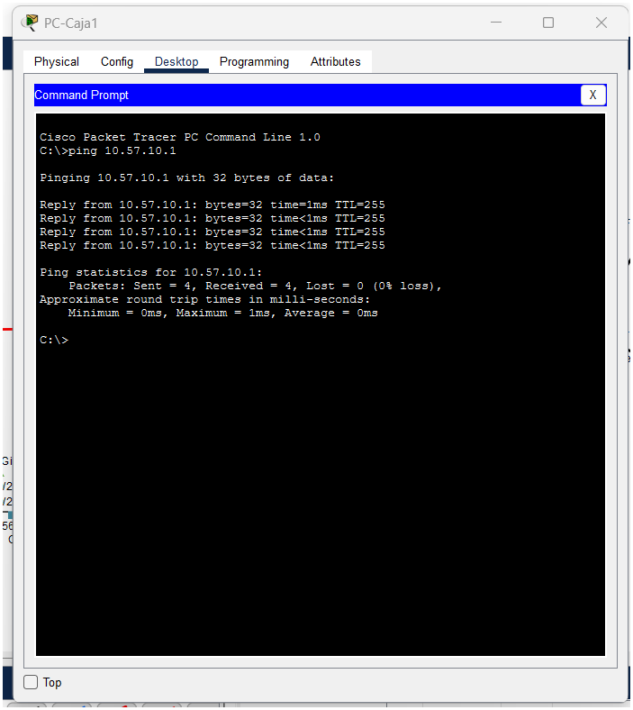

Caja1 - Asesores
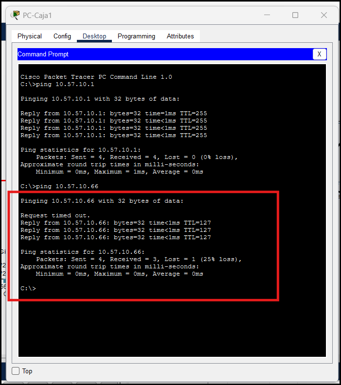

Caja1 - Gerencia
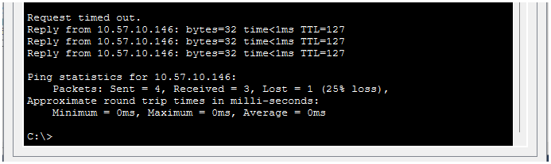

Caja1 - Core1
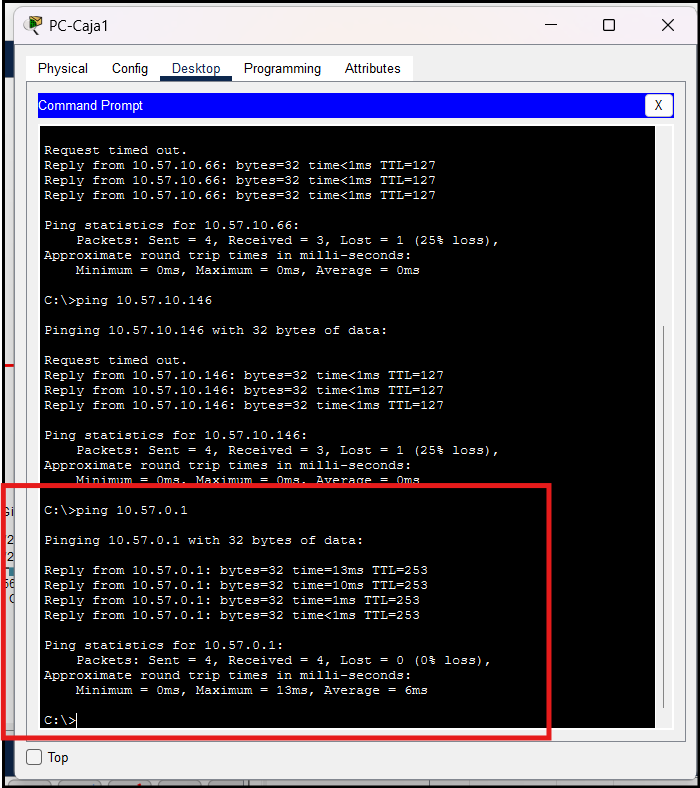


# Configuraciones (NORTE)
```cisco
        ---- SW-Norte-Principal VTP server y RootBridge ----

enable
configure terminal
hostname SW-Norte-Principal
no ip domain-lookup
line console 0
 logging synchronous
 exit

spanning-tree mode rapid-pvst
spanning-tree vlan 53,63,73 root primary

vtp domain bantech57
vtp password cisco
vtp mode server

vlan 53
 name Analisis
vlan 63
 name Auditoria
vlan 73
 name Legal
 exit

interface range fa0/1 - 3
 switchport mode trunk
 exit
end
write memory


                ---- SW-Norte-A1 (VTP client) -----

enable
configure terminal
hostname SW-Norte-A1
no ip domain-lookup
line console 0
 logging synchronous
 exit

spanning-tree mode rapid-pvst

vtp domain bantech57
vtp password cisco
vtp mode client

interface range fa0/1 - 2
 switchport mode trunk
 exit
end

               ---- SW-Norte-A2 (VTP client) -----
enable
configure terminal
hostname SW-Norte-A2
no ip domain-lookup
line console 0
 logging synchronous
 exit
spanning-tree mode rapid-pvst
vtp domain bantech57
vtp password cisco
vtp mode client
interface range fa0/1 - 2
 switchport mode trunk
 exit
end
```


Test vlan brief A1 (Propagacion desde principal)
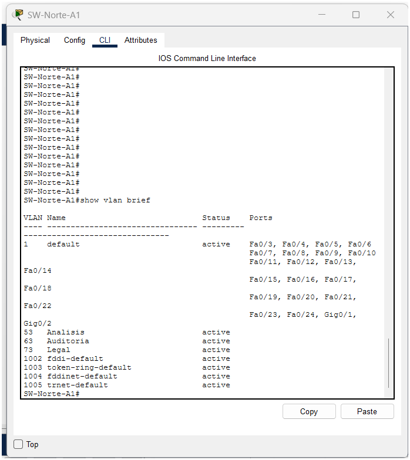

Test vlan brief A2 (Propagacion desde principal)
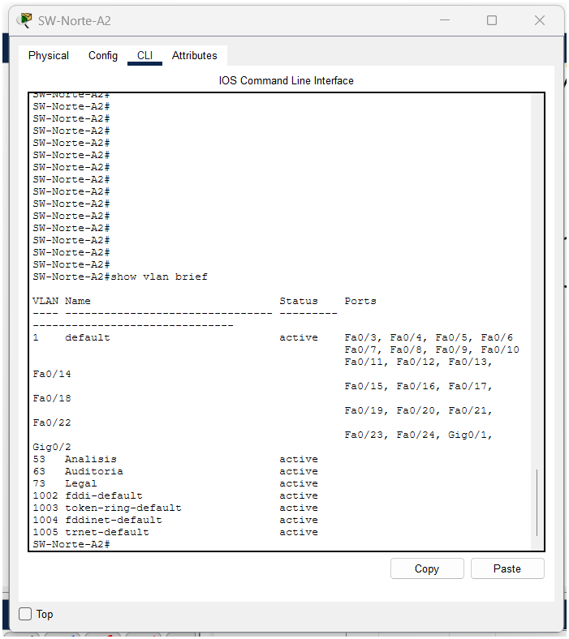

## Asignación de Puertos de las PCs NORTE

```cisco
                    ---- En SW-Norte-A1 ----
configure terminal

interface range fa0/3 - 4
 switchport mode access
 switchport access vlan 53
 exit

interface fa0/5
 switchport mode access
 switchport access vlan 63
 exit

end
write memory


                    ---- En SW-Norte-A2 ----

configure terminal

interface fa0/6
 switchport mode access
 switchport access vlan 53
 exit

interface fa0/3
 switchport mode access
 switchport access vlan 63
 exit

interface range fa0/4 - 5
 switchport mode access
 switchport access vlan 73
 exit

end
write memory
```


## R-Norte (router-on-a-stick y EIGRP)


```cisco
                        ---- Core1 ----
configure terminal

interface gi0/2
 no switchport
 ip address 10.57.0.17 255.255.255.252
 no shutdown
 exit

end
write memory


---- Configuración R-Norte (Router-on-a-stick y EIGRP) ----

enable
configure terminal
hostname R-Norte
no ip domain-lookup
line console 0
 logging synchronous
 exit

interface gi0/1
 ip address 10.57.0.18 255.255.255.252
 no shutdown
 exit

interface gi0/0
 no ip address
 no shutdown
 exit

interface gi0/0.53
 encapsulation dot1Q 53
 ip address 10.57.20.1 255.255.255.192
 exit

interface gi0/0.63
 encapsulation dot1Q 63
 ip address 10.57.20.65 255.255.255.224
 exit

interface gi0/0.73
 encapsulation dot1Q 73
 ip address 10.57.20.97 255.255.255.240
 exit

router eigrp 100
 network 10.57.20.0 0.0.0.255
 network 10.57.0.16 0.0.0.3
 no auto-summary
 exit
end
write memory
```


## IPs de las PCs de Norte

| PC | IP | Máscara | Gateway |
|----|----|---------|---------|
| Análisis 1 | 10.57.20.2 | 255.255.255.192 | 10.57.20.1 |
| Análisis 2 | 10.57.20.3 | 255.255.255.192 | 10.57.20.1 |
| Análisis 3 | 10.57.20.4 | 255.255.255.192 | 10.57.20.1 |
| Auditoría 1 | 10.57.20.66 | 255.255.255.224 | 10.57.20.65 |
| Auditoría 2 | 10.57.20.67 | 255.255.255.224 | 10.57.20.65 |
| Legal 1 | 10.57.20.98 | 255.255.255.240 | 10.57.20.97 |
| Legal 2 | 10.57.20.99 | 255.255.255.240 | 10.57.20.97 |

## Verificaciones

Test: Ping Analisis 1
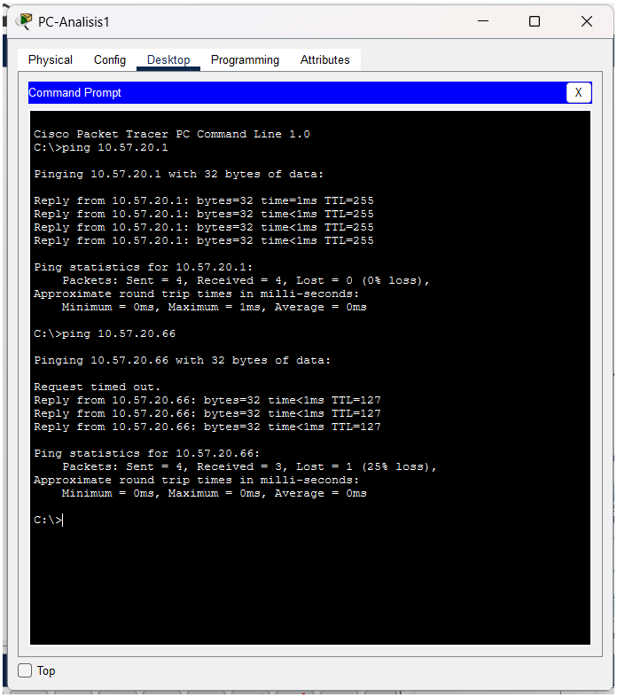


Spanning tree vlan 53
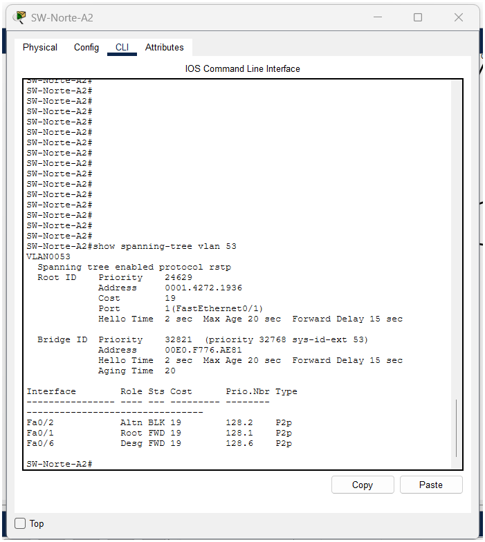


Rootbridge
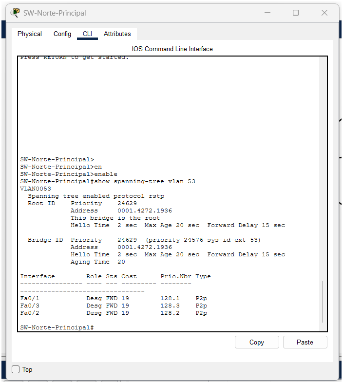


## Redistribución EIGRP - OSPF en Core1 

```cisco
                        ---- en Core1 ----
configure terminal

router eigrp 100
 network 10.57.0.16 0.0.0.3
 no auto-summary
 redistribute ospf 1 metric 10000 100 255 1 1500
 exit

router ospf 1
 redistribute eigrp 100 subnets
 exit

end
write memory
```
## Pruebas

- En **Core1**: `show ip eigrp neighbors` debe mostrar a R-Norte (10.57.0.18).
- En **Core1**: `show ip route` debe mostrar rutas **D** hacia `10.57.20.x`.

Test: show ip route
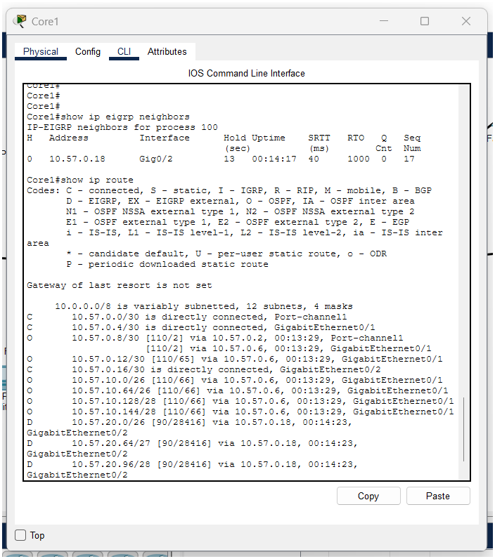


- En **R-Norte**: `show ip route` debe mostrar rutas **D EX** hacia `10.57.10.x` y `10.57.0.x`.

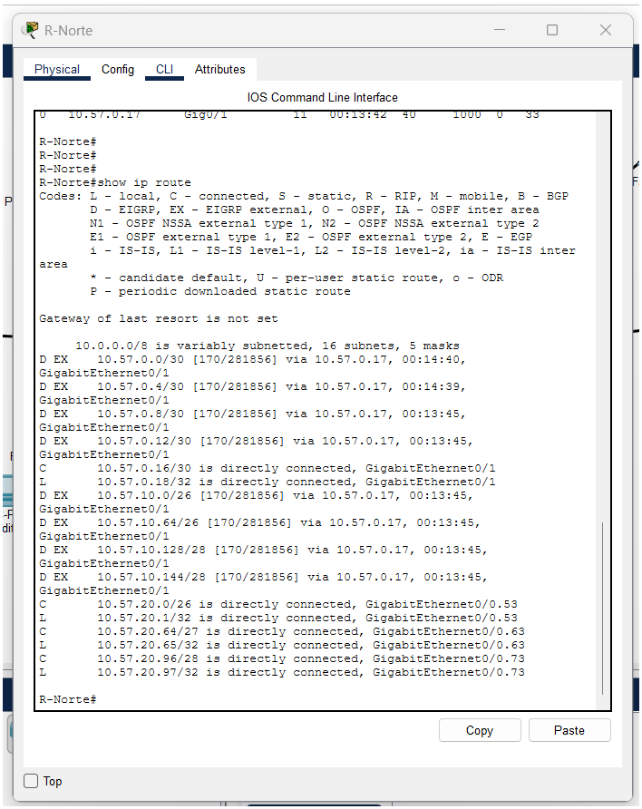

- Desde **Análisis 1**: `ping 10.57.10.2` (Cajas 1, en Occidente).

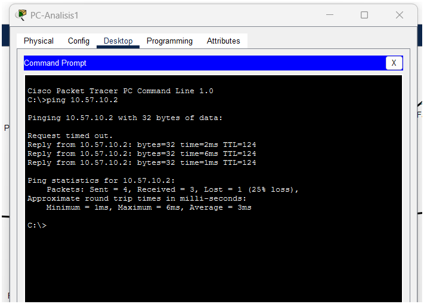


# Configuraciones (Oriente)

Topologia Oriente


## Configuración de Switches Core Oriente (MS1 y MS2)


```cisco
                -----MS1 (VTP server, HSRP activo, root)----
enable
configure terminal
hostname MS1
no ip domain-lookup
ip routing
line console 0
 logging synchronous
 exit

spanning-tree mode rapid-pvst
spanning-tree vlan 83,93 root primary

vtp domain bantech57
vtp password cisco
vtp mode server

vlan 83
 name Boveda
vlan 93
 name Plataforma
 exit

interface range fa0/1 , fa0/23
 switchport trunk encapsulation dot1q
 switchport mode trunk
 exit

interface gi0/1
 no switchport
 ip address 10.57.0.26 255.255.255.252
 no shutdown
 exit

interface vlan 83
 ip address 10.57.30.130 255.255.255.192
 standby 83 ip 10.57.30.129
 standby 83 priority 110
 standby 83 preempt
 no shutdown
 exit

interface vlan 93
 ip address 10.57.30.2 255.255.255.128
 standby 93 ip 10.57.30.1
 standby 93 priority 110
 standby 93 preempt
 no shutdown
 exit

router rip
 version 2
 no auto-summary
 network 10.0.0.0
 exit
end
write memory


        ----- MS2 (VTP client, HSRP standby) -----
enable
configure terminal
hostname MS2
no ip domain-lookup
ip routing
line console 0
 logging synchronous
 exit

spanning-tree mode rapid-pvst

vtp domain bantech57
vtp password cisco
vtp mode client

interface range fa0/1 , fa0/23
 switchport trunk encapsulation dot1q
 switchport mode trunk
 exit

interface gi0/1
 no switchport
 ip address 10.57.0.30 255.255.255.252
 no shutdown
 exit

interface vlan 83
 ip address 10.57.30.131 255.255.255.192
 standby 83 ip 10.57.30.129
 standby 83 priority 100
 standby 83 preempt
 no shutdown
 exit

interface vlan 93
 ip address 10.57.30.3 255.255.255.128
 standby 93 ip 10.57.30.1
 standby 93 priority 100
 standby 93 preempt
 no shutdown
 exit

router rip
 version 2
 no auto-summary
 network 10.0.0.0
 exit
end
write memory

                ----- Configuración SW-Oriente-Acceso (VTP client) -----
enable
configure terminal
hostname SW-Oriente-Acceso
no ip domain-lookup
line console 0
 logging synchronous
 exit

spanning-tree mode rapid-pvst

vtp domain bantech57
vtp password cisco
vtp mode client

interface range fa0/1 - 2
 switchport mode trunk
 exit
end
```

## Configuraciones de Acceso y Core (Oriente) 


```cisco
        ----- SW-Oriente-Acceso (Modo Access para las PCs) -----
configure terminal

interface range fa0/3 - 6
 switchport mode access
 switchport access vlan 83
 exit

interface range fa0/7 - 9
 switchport mode access
 switchport access vlan 93
 exit

end
write memory

                ---- Core1 con enlace hacia MS1 ----
configure terminal

interface fa0/1
 no switchport
 ip address 10.57.0.25 255.255.255.252
 no shutdown
 exit

end
write memory


                ---- Core2 con enlace hacia MS2 ----
configure terminal

interface gi0/2
 no switchport
 ip address 10.57.0.29 255.255.255.252
 no shutdown
 exit

end
write memory
```

## IPs de las PCs (Oriente)

| PC | IP | Máscara | Gateway |
|----|----|---------|---------|
| Bóveda 1 | 10.57.30.132 | 255.255.255.192 | 10.57.30.129 |
| Bóveda 2 | 10.57.30.133 | 255.255.255.192 | 10.57.30.129 |
| Bóveda 3 | 10.57.30.134 | 255.255.255.192 | 10.57.30.129 |
| Bóveda 4 | 10.57.30.135 | 255.255.255.192 | 10.57.30.129 |
| Plataforma 1 | 10.57.30.4 | 255.255.255.128 | 10.57.30.1 |
| Plataforma 2 | 10.57.30.5 | 255.255.255.128 | 10.57.30.1 |
| Plataforma 3 | 10.57.30.6 | 255.255.255.128 | 10.57.30.1 |

## Verificaciones


1. **MS1 y MS2:** `show standby brief`


2. **SW-Ori-Acceso:** `show vlan brief`


3. **Cada PC a su gateway virtual:** 10.57.30.129 (Bóveda) y 10.57.30.1 (Plataforma)


## Redistribución RIPv2 ↔ OSPF en Core2

```cisco

                        ---- Core2 ----
configure terminal

router rip
 version 2
 no auto-summary
 network 10.0.0.0
 passive-interface default
 no passive-interface gi0/2
 redistribute ospf 1 metric 3
 exit

router ospf 1
 redistribute rip subnets
 exit

end
write memory
```

## Verificaciones:
 

**Enlace Core2 y MS2 funcionando**


**RIP v2 activo**
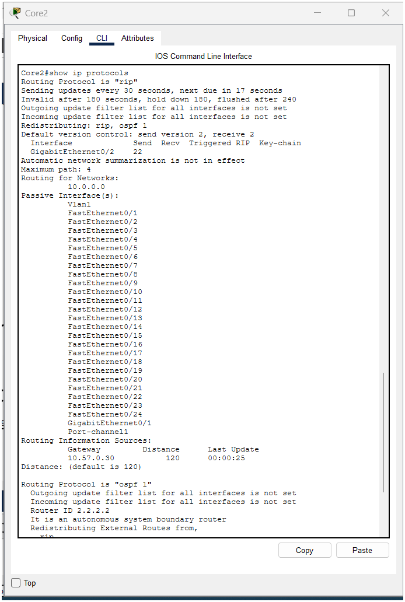

**Core2 aprendió 10.57.30.0/25 y 10.57.30.128/26 por MS2** 
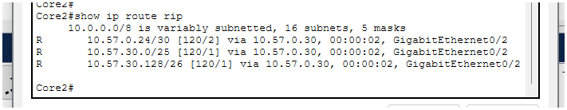

**Las redes de Oriente aparecen como O E2**
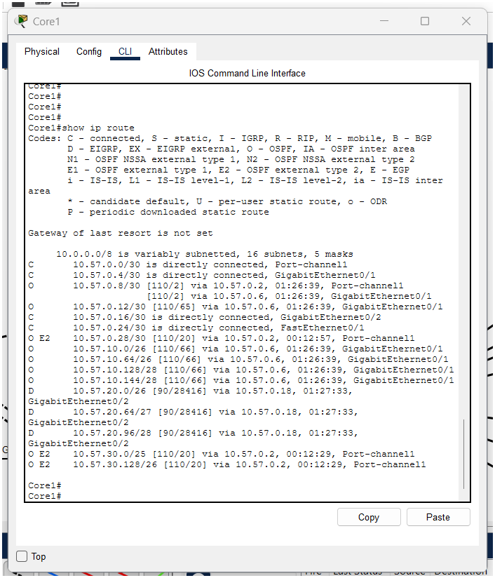

**Las redes de Oriente aparecen como D EX**
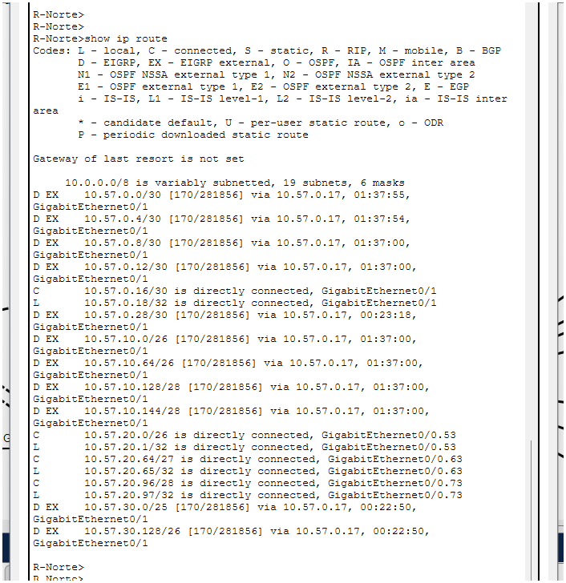

**Convergencia de extremo a extremo**
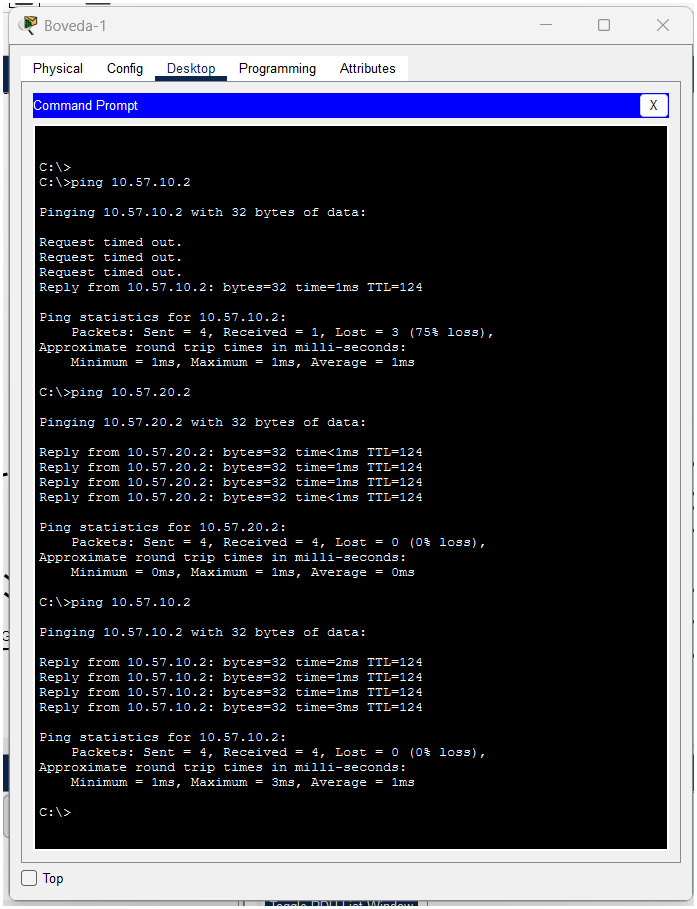

**El camino de regreso**
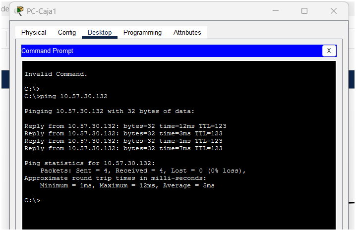


# Configuraciones Sede Central

```cisco
                ----Core2 (lado hacia Central)----
configure terminal

interface fa0/1
 no switchport
 ip address 10.57.0.21 255.255.255.252
 no shutdown
 exit

router ospf 1
 network 10.57.0.20 0.0.0.3 area 0
 exit

end
write memory
                ---- Router Central 1 (De estadisticas hacia OSPF)----

enable
configure terminal
hostname R-Central1
no ip domain-lookup
line console 0
 logging synchronous
 exit

interface gi0/0
 ip address 10.57.0.22 255.255.255.252
 no shutdown
 exit

interface gi0/1
 ip address 10.57.0.33 255.255.255.252
 no shutdown
 exit

ip route 10.57.40.0 255.255.255.224 10.57.0.34
ip route 10.57.40.32 255.255.255.240 10.57.0.34
ip route 10.57.40.48 255.255.255.240 10.57.0.34
ip route 10.57.0.36 255.255.255.252 10.57.0.34

router ospf 1
 router-id 5.5.5.5
 network 10.57.0.20 0.0.0.3 area 0
 redistribute static subnets
 exit

end
write memory

                ---- R-Central2 Router de Acceso ----
enable
configure terminal
hostname R-Central2
no ip domain-lookup
line console 0
 logging synchronous
 exit

interface gi0/0
 ip address 10.57.0.34 255.255.255.252
 no shutdown
 exit

interface gi0/1
 ip address 10.57.0.37 255.255.255.252
 no shutdown
 exit

ip route 0.0.0.0 0.0.0.0 10.57.0.33
ip route 10.57.40.0 255.255.255.224 10.57.0.38
ip route 10.57.40.32 255.255.255.240 10.57.0.38
ip route 10.57.40.48 255.255.255.240 10.57.0.38

end
write memory

                ---- Switch-SedeCentral-Distribucion (3560, VTP Server) ----

enable
configure terminal
hostname SW-DC-Dist
no ip domain-lookup
ip routing
line console 0
 logging synchronous
 exit

vtp domain bantech57
vtp password cisco
vtp mode server

vlan 14
 name Core_BD
vlan 24
 name Web_Apps
vlan 34
 name NOC
 exit

interface range fa0/23 - 24
 switchport trunk encapsulation dot1q
 switchport mode trunk
 channel-group 2 mode active
 no shutdown
 exit

interface port-channel 2
 switchport trunk encapsulation dot1q
 switchport mode trunk
 exit

interface gi0/1
 no switchport
 ip address 10.57.0.38 255.255.255.252
 no shutdown
 exit

interface vlan 14
 ip address 10.57.40.33 255.255.255.240
 no shutdown
 exit

interface vlan 24
 ip address 10.57.40.1 255.255.255.224
 no shutdown
 exit

interface vlan 34
 ip address 10.57.40.49 255.255.255.240
 no shutdown
 exit

ip route 0.0.0.0 0.0.0.0 10.57.0.37

end
write memory

                ---- SW-SedeCentral-Acceso (2960, VTP Cliente)----

enable
configure terminal
hostname SW-DC-Acceso
no ip domain-lookup
line console 0
 logging synchronous
 exit

vtp domain bantech57
vtp password cisco
vtp mode client

interface range fa0/23 - 24
 switchport mode trunk
 channel-group 2 mode active
 no shutdown
 exit

interface port-channel 2
 switchport mode trunk
 exit

end

                ---- Asignar los puertos en SW-SedeCentral-Acceso ----

configure terminal
interface range fa0/1 - 3
 switchport mode access
 switchport access vlan 14
 exit
interface range fa0/4 - 6
 switchport mode access
 switchport access vlan 24
 exit
interface fa0/7
 switchport mode access
 switchport access vlan 34
 exit
end
write memory

```

### Creacion de Vlans


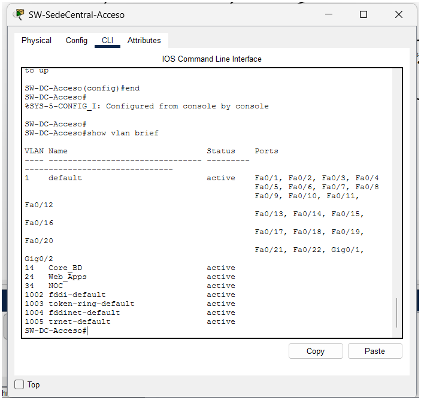

## IPs de los servidores

| Equipo | IP | Máscara | Gateway |
|--------|----|---------|---------|
| Core_BD 1 | 10.57.40.34 | 255.255.255.240 | 10.57.40.33 |
| Core_BD 2 | 10.57.40.35 | 255.255.255.240 | 10.57.40.33 |
| Core_BD 3 | 10.57.40.36 | 255.255.255.240 | 10.57.40.33 |
| Web_Apps 1 | 10.57.40.2 | 255.255.255.224 | 10.57.40.1 |
| Web_Apps 2 | 10.57.40.3 | 255.255.255.224 | 10.57.40.1 |
| Web_Apps 3 | 10.57.40.4 | 255.255.255.224 | 10.57.40.1 |
| NOC 1 | 10.57.40.50 | 255.255.255.240 | 10.57.40.49 |

---

# Verificaciones


**Test Etherchannel summary SW Distribucion**
  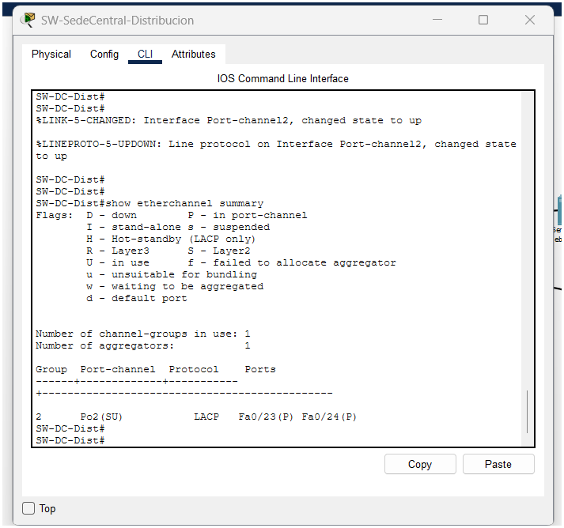

**Test Etherchannel summary SW Acceso**
  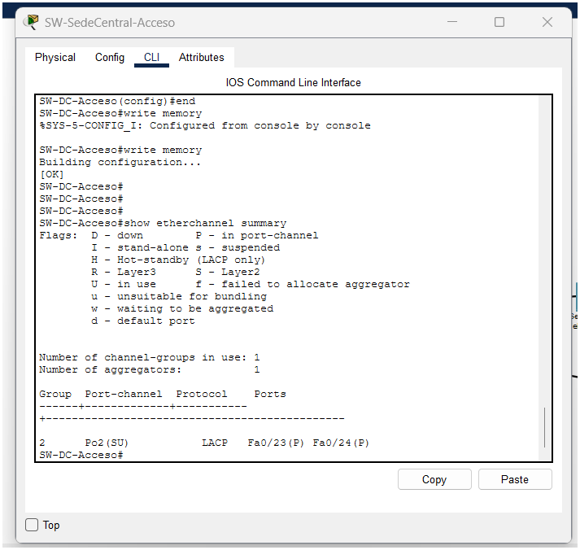

**R-Central1:** 
show ip route, con rutas (S) hacia 10.57.40.x y (O) hacia el resto.
  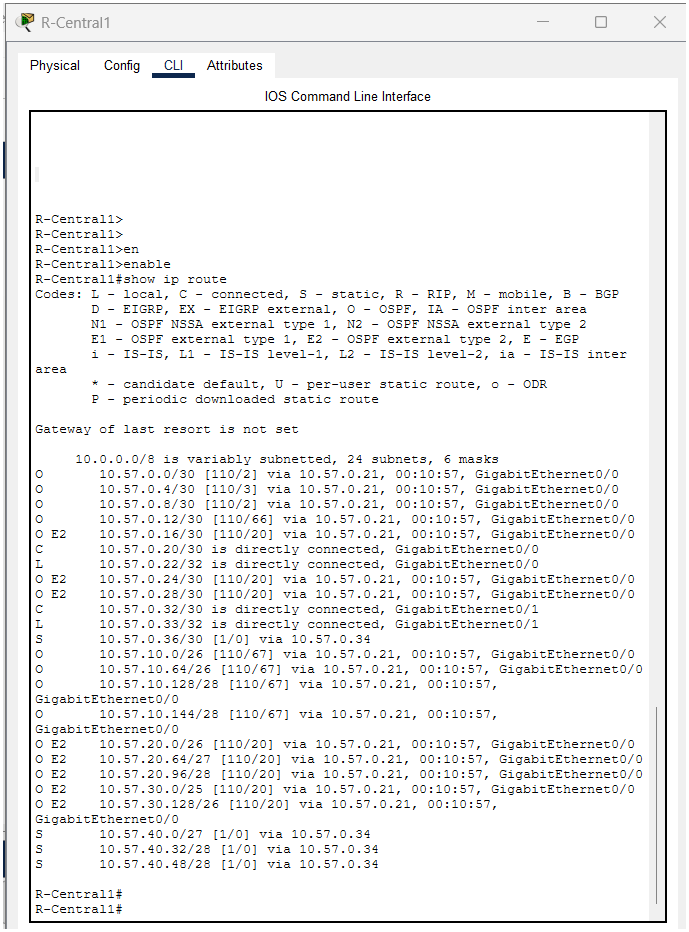  

**Core1:** show ip route, con 10.57.40.x como (O E2).
  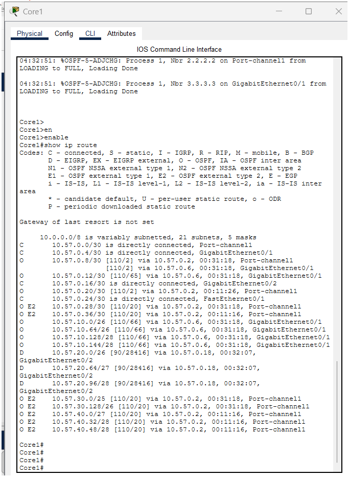

- **NOC 1:** `ping 10.57.10.2` (Occidente), `ping 10.57.20.2` (Norte) y `ping 10.57.30.132` (Oriente).
  > [CAPTURA] Pings-NOC1-hacia-occidente-norte-oriente

- **Web_Apps 1:** `ping 10.57.40.34` (inter-VLAN en el Dist).
  > [CAPTURA] WebApps1-Pings-InterVlan


# Capturas

Topologia del core
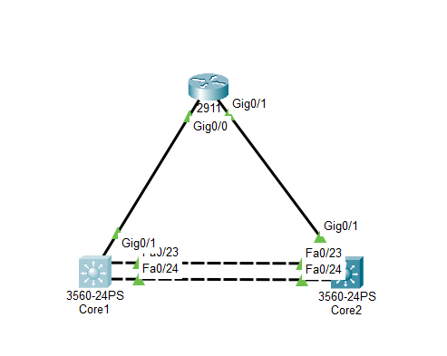
## Core2 (lado hacia Central)

```cisco
configure terminal

interface fa0/1
 no switchport
 ip address 10.57.0.21 255.255.255.252
 no shutdown
 exit

router ospf 1
 network 10.57.0.20 0.0.0.3 area 0
 exit

end
write memory

ping del core
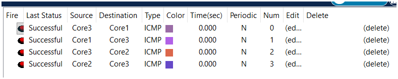

Prueba OSPF
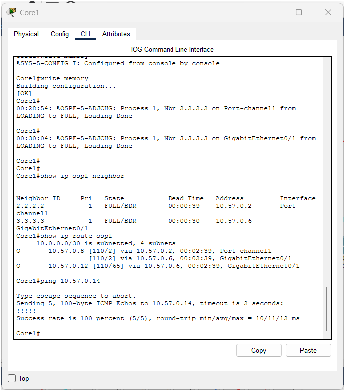

Topologia Occidente
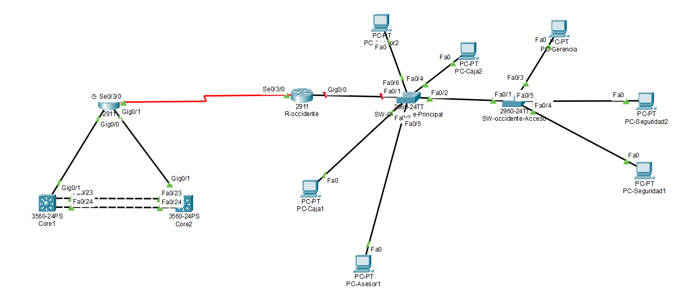

Vlans Occidente
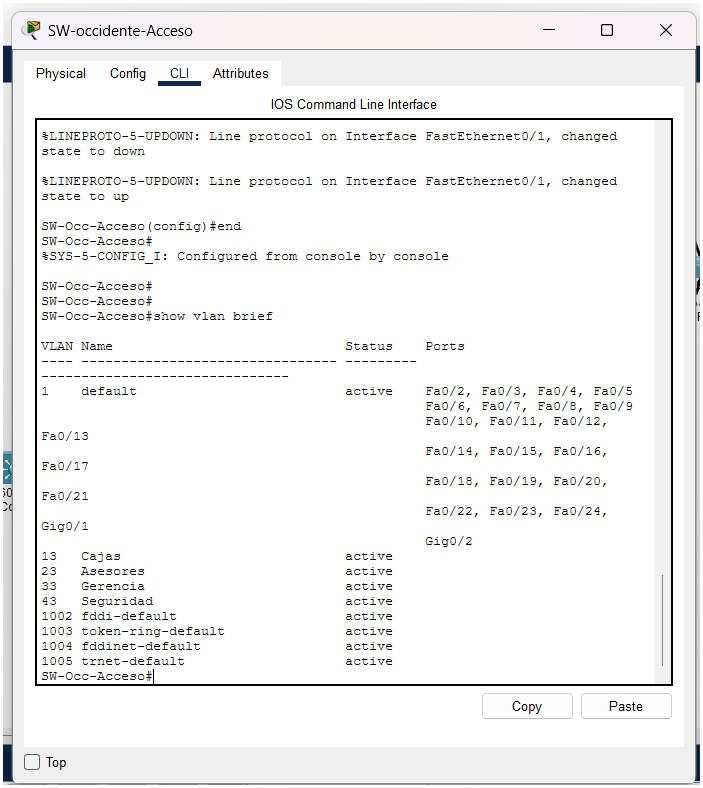

