# TAREA 5
- Maria Zucely Hernández García
- 201701160

## Topologia

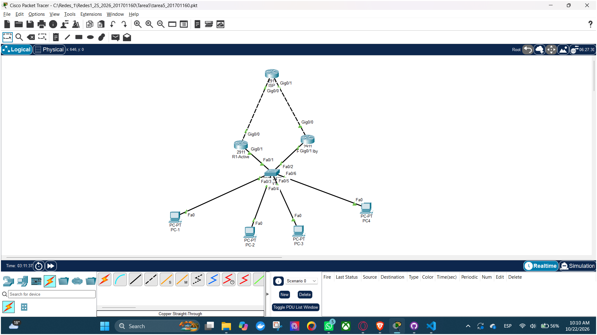

## Subneteo
Carné **201701160**:

- **YY = 16**, red base: **192.168.16.0/24**.
- **X = 0**,  las VLAN son **VLAN 10 (Administración)** y **VLAN 20 (Operaciones)**.


### Cálculo

Se necesitan 2 redes, así que se toma 1 bit prestado del host (2¹ = 2 subredes):

- Máscara: `/24` pasa a `/25` = **255.255.255.128**
- Hosts por subred: `2⁷ − 2 = 126`
- Salto (incremento): `256 − 128 = 128`

### Tabla de Subneteo

| VLAN | Nombre         | Red            | Máscara                | Primera IP útil | Última IP útil | Broadcast       |
|------|----------------|----------------|------------------------|-----------------|----------------|-----------------|
| 10   | Administracion | 192.168.16.0   | /25 (255.255.255.128)  | 192.168.16.1    | 192.168.16.126 | 192.168.16.127  |
| 20   | Operaciones    | 192.168.16.128 | /25 (255.255.255.128)  | 192.168.16.129  | 192.168.16.254 | 192.168.16.255  |

### Plan de direccionamiento

| Dispositivo                          | VLAN 10        | VLAN 20        |
|--------------------------------------|----------------|----------------|
| IP virtual HSRP (gateway de las PCs) | 192.168.16.1   | 192.168.16.129 |
| R1-Activo (subinterfaz)              | 192.168.16.2   | 192.168.16.130 |
| R2-Standby (subinterfaz)             | 192.168.16.3   | 192.168.16.131 |
| PC1                                  | 192.168.16.10  |                |
| PC2                                  | 192.168.16.11  |                |
| PC3                                  |                | 192.168.16.140 |
| PC4                                  |                | 192.168.16.141 |

## VLANs, puertos de acceso y troncales en SW1

### Comandos

```cisco
enable
configure terminal
hostname SW1

vlan 10
 name Administracion
vlan 20
 name Operaciones
exit

interface range fastEthernet 0/3 - 4
 switchport mode access
 switchport access vlan 10
exit

interface range fastEthernet 0/5 - 6
 switchport mode access
 switchport access vlan 20
exit

interface range fastEthernet 0/1 - 2
 switchport mode trunk
exit

end
write memory
```

### Qué hace cada bloque

- **`vlan 10` / `name`**: crea la VLAN y le pone nombre.
- **`interface range fa0/3 - 4`**: configura varios puertos a la vez. PC1 y PC2 quedan en la VLAN 10.
- **`switchport mode access`**: el puerto pertenece a una sola VLAN (para PCs).
- **`interface range fa0/1 - 2` con `switchport mode trunk`**: son los puertos hacia R1 y R2. Un troncal transporta varias VLAN con etiquetas 802.1Q.

### Verificación

*Salida del comando `show vlan brief` en SW1 mostrando las VLAN 10 y 20.*

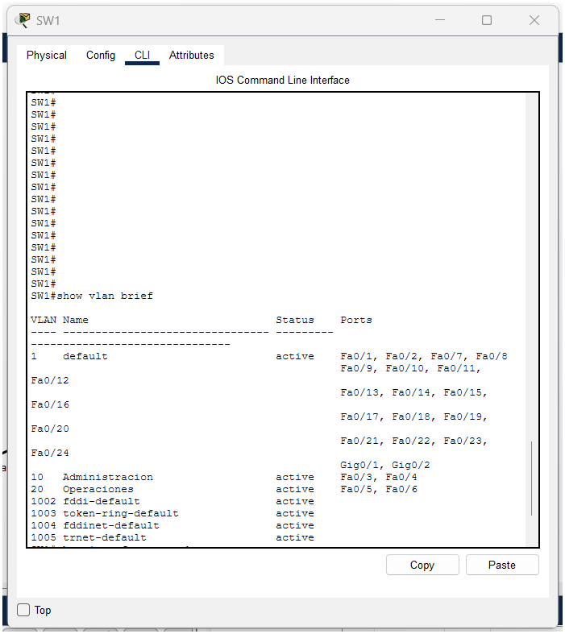

## Ruteo InterVLAN (Router-on-a-Stick) en R1 y R2

Cada router recibe un solo cable del switch (Gi0/1), pero por ahí viajan las dos VLAN. Para que el router las separe, se debe dividir esa interfaz en subinterfaces, una por VLAN, cada una con su IP. Así los routers pueden pasar tráfico de la VLAN 10 a la VLAN 20.

### R1-Activo

```cisco
enable
configure terminal
hostname R1-Activo

interface gigabitEthernet 0/1
 no shutdown
exit

interface gigabitEthernet 0/1.10
 encapsulation dot1Q 10
 ip address 192.168.16.2 255.255.255.128
exit

interface gigabitEthernet 0/1.20
 encapsulation dot1Q 20
 ip address 192.168.16.130 255.255.255.128
exit

end
write memory
```

### R2-Standby

```cisco
enable
configure terminal
hostname R2-Standby

interface gigabitEthernet 0/1
 no shutdown
exit

interface gigabitEthernet 0/1.10
 encapsulation dot1Q 10
 ip address 192.168.16.3 255.255.255.128
exit

interface gigabitEthernet 0/1.20
 encapsulation dot1Q 20
 ip address 192.168.16.131 255.255.255.128
exit

end
write memory
```

### Qué hace cada parte

- **`interface gi0/1` + `no shutdown`**: enciende la interfaz física. No lleva IP, solo sirve de “tubo” para las subinterfaces.
- **`interface gi0/1.10`**: crea la subinterfaz lógica para la VLAN 10.
- **`encapsulation dot1Q 10`**: le dice que atienda las tramas etiquetadas con VLAN 10. Debe coincidir con el número de VLAN.
- **`ip address ...`**: la IP real de ese router en esa VLAN (no la virtual, esa viene con HSRP).

### Configuración IP de las PCs

| PC   | IP             | Máscara         | Gateway        |
|------|----------------|-----------------|----------------|
| PC1  | 192.168.16.10  | 255.255.255.128 | 192.168.16.1   |
| PC2  | 192.168.16.11  | 255.255.255.128 | 192.168.16.1   |
| PC3  | 192.168.16.140 | 255.255.255.128 | 192.168.16.129 |
| PC4  | 192.168.16.141 | 255.255.255.128 | 192.168.16.129 |

> El gateway ya es la IP virtual de HSRP (.1 y .129), que será el definitivo.

### Verificación

#### Verificación Show Interfaces Brief y Show ip Route en R1

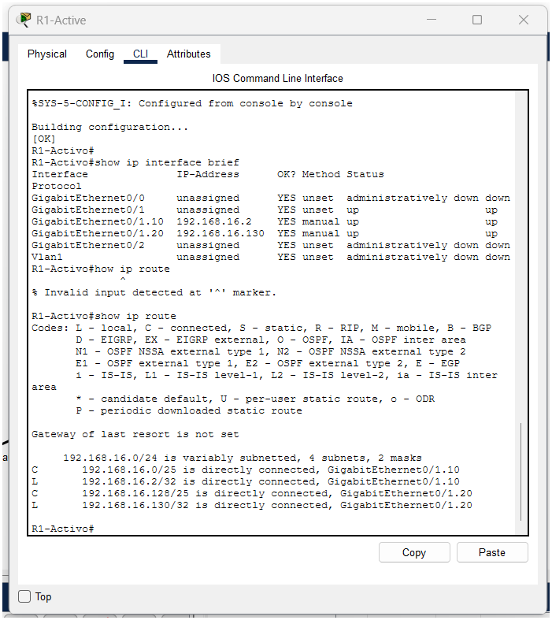

#### Verificación Show Interfaces Brief y Show ip Route en R2

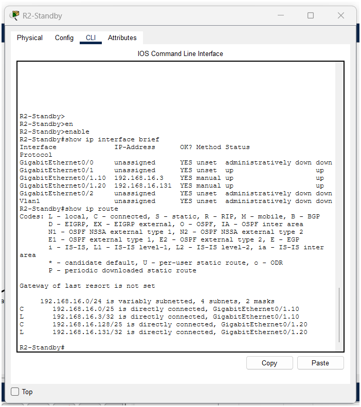


#### Verificación de las PCs


**Ping de PC1 a los routers**  
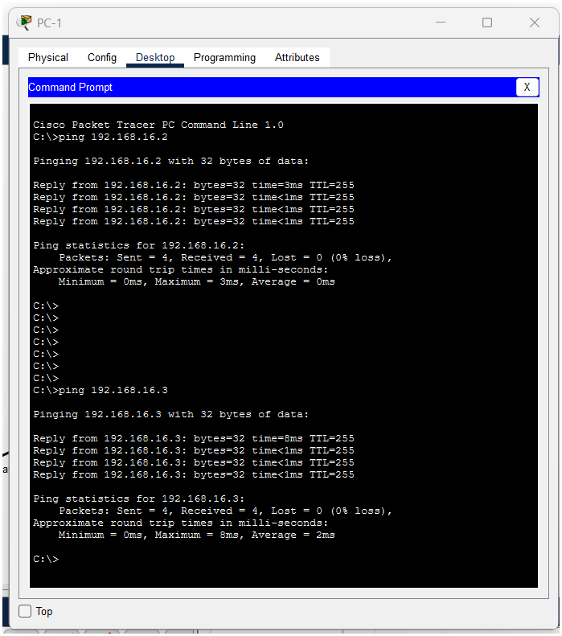  

**Ping de PCs a los routers**  
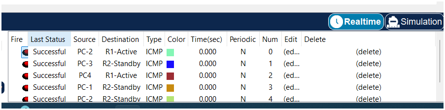

#### Verificación de troncales en SW1

**`show interfaces trunk` en SW1**  
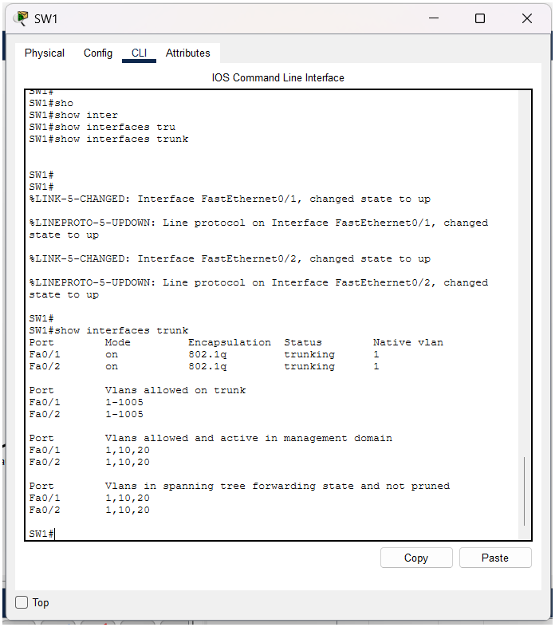  

## Enrutamiento dinámico (OSPF) hacia el ISP

Hay que darle IP a los enlaces entre los routers y el ISP, y activar OSPF para que los tres routers aprendan las rutas entre sí automáticamente.

### Direccionamiento de los enlaces al ISP

Estos enlaces necesitan su propia red, distinta a la 192.168.16.0/24. Se usan redes /30 (solo 2 IP útiles, ideales para enlaces punto a punto):

| Enlace | Red | ISP | Router |
|--------|-----|-----|--------|
| ISP Gi0/0 ↔ R1 Gi0/0 | 10.0.1.0/30 | 10.0.1.1 | R1: 10.0.1.2 |
| ISP Gi0/1 ↔ R2 Gi0/0 | 10.0.2.0/30 | 10.0.2.1 | R2: 10.0.2.2 |

> Además, el ISP tendrá una interfaz loopback (10.10.10.10) para simular “Internet” y poder hacer pruebas.

### ISP

```cisco
enable
configure terminal
hostname ISP

interface gigabitEthernet 0/0
 ip address 10.0.1.1 255.255.255.252
 no shutdown
exit

interface gigabitEthernet 0/1
 ip address 10.0.2.1 255.255.255.252
 no shutdown
exit

interface loopback 0
 ip address 10.10.10.10 255.255.255.255
exit

router ospf 1
 network 10.0.1.0 0.0.0.3 area 0
 network 10.0.2.0 0.0.0.3 area 0
 network 10.10.10.10 0.0.0.0 area 0
exit

end
write memory
```

### R1-Activo


```cisco
enable
configure terminal

interface gigabitEthernet 0/0
 ip address 10.0.1.2 255.255.255.252
 no shutdown
exit

router ospf 1
 network 10.0.1.0 0.0.0.3 area 0
 network 192.168.16.0 0.0.0.127 area 0
 network 192.168.16.128 0.0.0.127 area 0
 passive-interface gigabitEthernet 0/1.10
 passive-interface gigabitEthernet 0/1.20
exit

end
write memory
``` 

### R2-Standby

```
enable
configure terminal

interface gigabitEthernet 0/0
 ip address 10.0.2.2 255.255.255.252
 no shutdown
exit

router ospf 1
 network 10.0.2.0 0.0.0.3 area 0
 network 192.168.16.0 0.0.0.127 area 0
 network 192.168.16.128 0.0.0.127 area 0
 passive-interface gigabitEthernet 0/1.10
 passive-interface gigabitEthernet 0/1.20
exit

end
write memory
```

### Qué hace cada parte

- **`router ospf 1`**: activa OSPF (el 1 es solo un identificador local del proceso).
- **`network ... area 0`**: indica qué redes se anuncian. Se usa máscara wildcard (la inversa de la máscara): /30 → 0.0.0.3, /25 → 0.0.0.127.
- **`passive-interface`**: evita que OSPF mande mensajes hacia las subinterfaces de las VLAN, donde solo hay PCs. Las redes se siguen anunciando.

### Verificación

En R1, R2 e ISP:

**`Show ip route y show ip ospf neighbor` en R1-Active**  
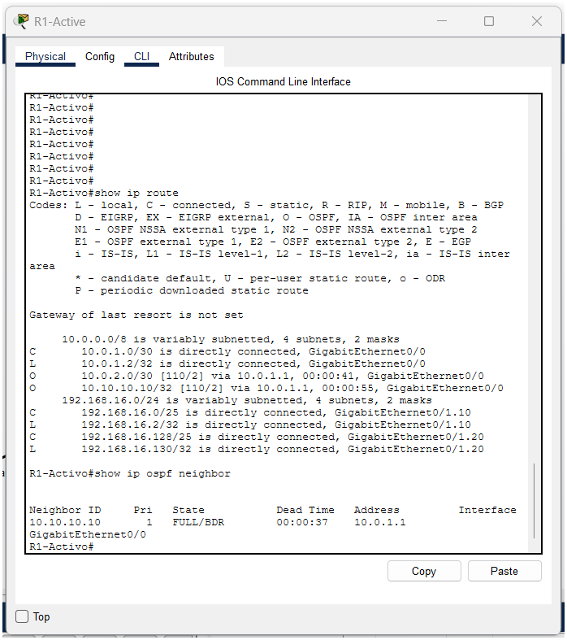  

**`Show ip route y show ip ospf neighbor` en R2-Standby**  
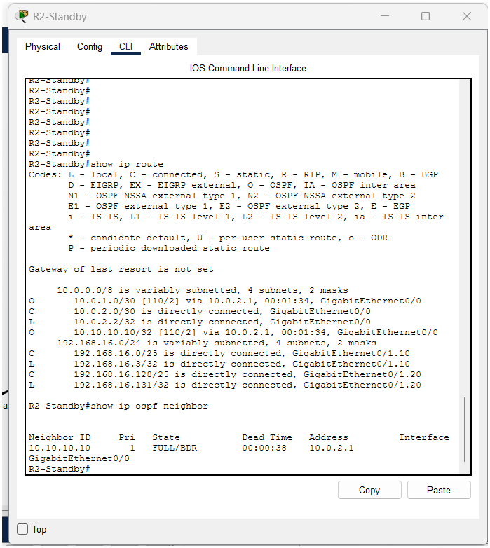  

**`Show ip route y show ip ospf neighbor` en ISP**  
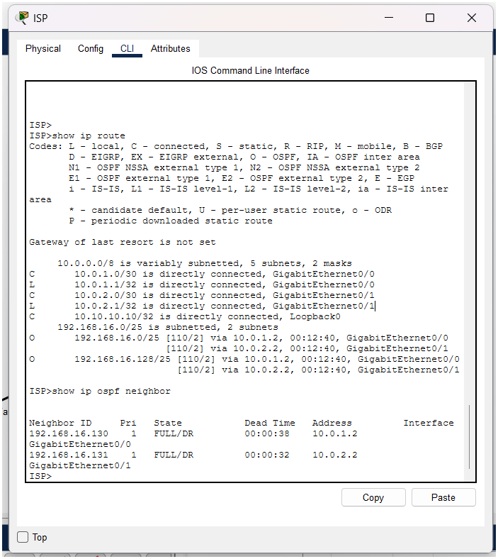  

**`Ping desde` **R1** `a 10.10.10.10`**  
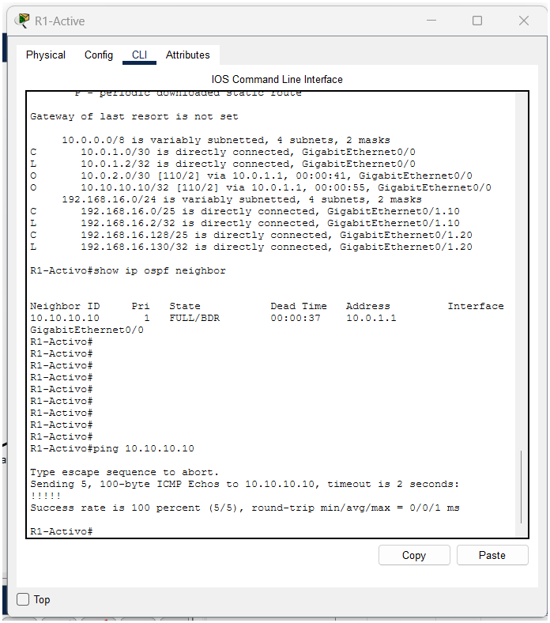  


## HSRP

HSRP hace que R1 y R2 compartan una IP virtual por VLAN. Las PCs usan esa IP como gateway (.1 y .129). Un router está **Active** (responde por la IP virtual) y el otro **Standby** (espera). Si el Active falla, el Standby toma el control.

### Cómo se decide quién es Active

Gana el que tenga mayor `priority` (por defecto 100). Se le pone 110 a R1 y se agrega `preempt`, para que R1 recupere el rol Active cuando vuelva tras una falla.

### R1-Activo

```cisco
enable
configure terminal

interface gigabitEthernet 0/1.10
 standby version 2
 standby 10 ip 192.168.16.1
 standby 10 priority 110
 standby 10 preempt
exit

interface gigabitEthernet 0/1.20
 standby version 2
 standby 20 ip 192.168.16.129
 standby 20 priority 110
 standby 20 preempt
exit

end
write memory
```

### R2-Standby

```
enable
configure terminal

interface gigabitEthernet 0/1.10
 standby version 2
 standby 10 ip 192.168.16.1
 standby 10 preempt
exit

interface gigabitEthernet 0/1.20
 standby version 2
 standby 20 ip 192.168.16.129
 standby 20 preempt
exit

end
write memory
```

### Qué hace cada línea

- **`standby version 2`**: usa HSRP v2 (lo uso aquí para evitar conflictos con subinterfaces; ponlo en ambos routers).
- **`standby 10 ip ...`**: el número 10 es el grupo (uso uno por VLAN) y la IP es la virtual.
- **`priority 110`**: R1 gana la elección y queda Active.
- **`preempt`**: permite que el router con mayor prioridad retome el rol Active.

### Verificación

`show standby brief` y 
`show standby` en **R1-Active**
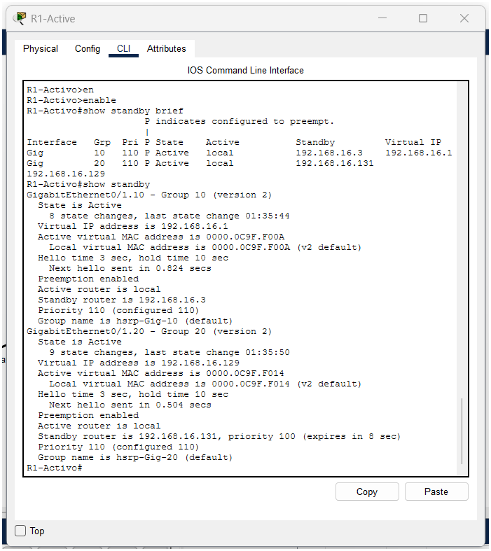

`show standby brief` y 
`show standby` en **R1-Standby**
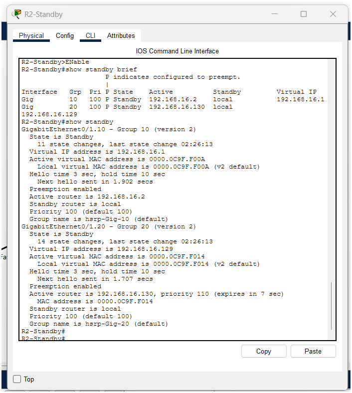


Ping a **IP virtual** `192.168.16.1` y a **PC-3**
`192.168.16.140` desde **PC-1**
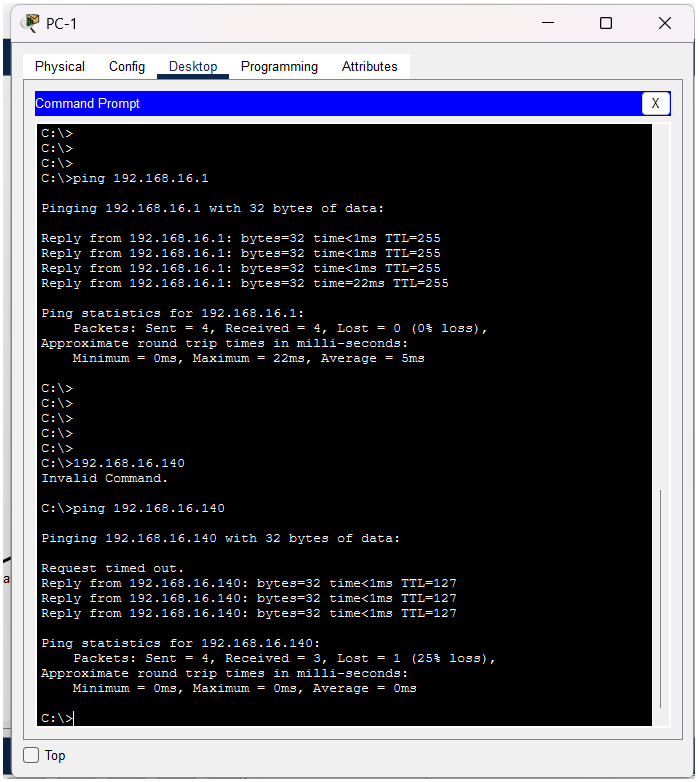

## Prueba de fallo

El objetivo es demostrar que, al caerse R1 (el Active), R2 toma el tráfico y el ping no se corta (o se pierden solo uno o dos paquetes).

### 1. Iniciar el ping sostenido

En PC1, Command Prompt:

```cmd
ping -t 192.168.16.140
```

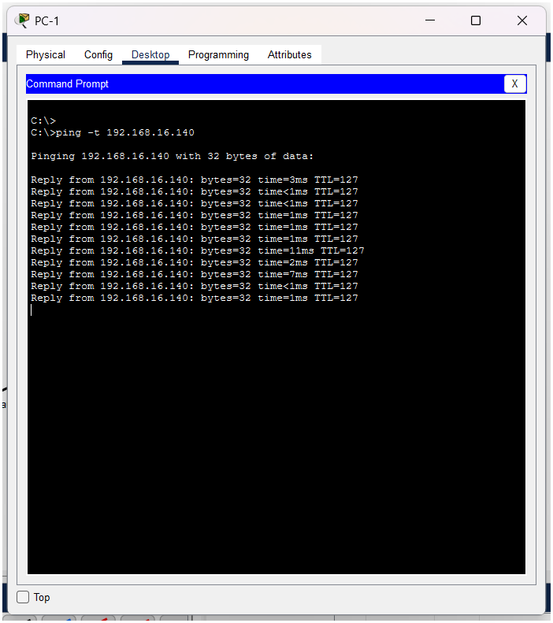

Se verá la respuesta contínua (Reply from...).

### 2. Apagar la interfaz de R1

Mientras el ping corre, en R1-Activo:

```cisco
enable
configure terminal
interface gigabitEthernet 0/1
 shutdown
end
```

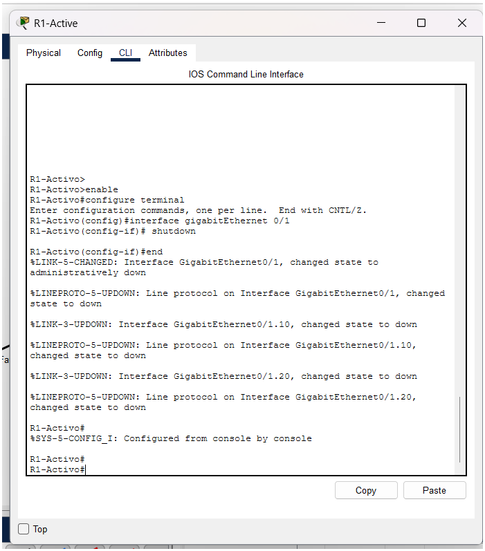

Aqui se apaga la física Gi0/1 (no las subinterfaces) porque simula la caída del enlace completo hacia el switch.

### 3. Observar el ping en PC1

Se verán uno o varios `Request timed out` y luego las respuestas se reanudan solas. Ese corte es el tiempo que tarda HSRP en detectar la falla (hasta unos 10 segundos con el hold time por defecto). Después del cambio, el ping continúa por R2.


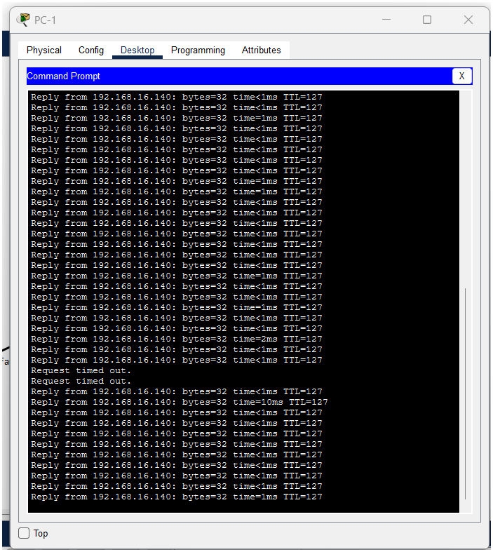

### 4. Verificar el cambio en R2

En R2-Standby:

```cisco
show standby brief
```


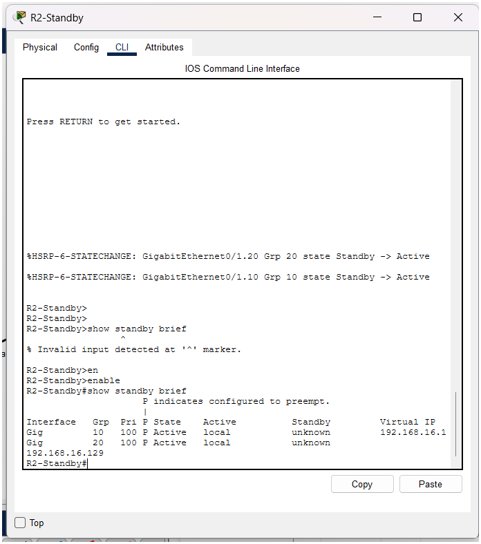

Los grupos 10 y 20 deben aparecer ahora como **Active**. 

**Muestra de las 3 ventanas sucediendo a la vez**


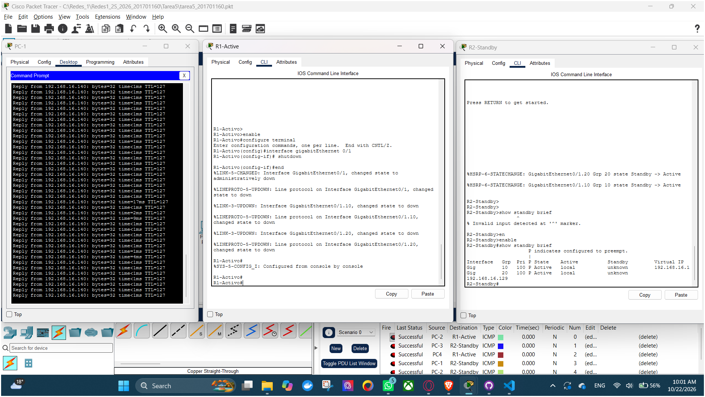

### 5. Detener el ping

En PC1 presionar `Ctrl + C` para ver las estadísticas finales.


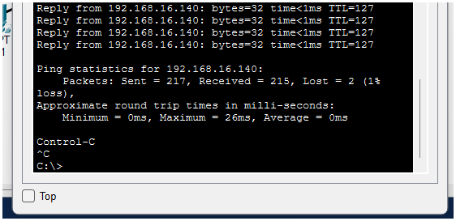


### Recuperación (preempt)

Para mostrar que R1 recupera el rol, en R1 se ejecuta:

```cisco
configure terminal
interface gigabitEthernet 0/1
 no shutdown
end
```

Hay que sperar unos segundos y ejecutar show standby brief en R1: debería volver a Active.

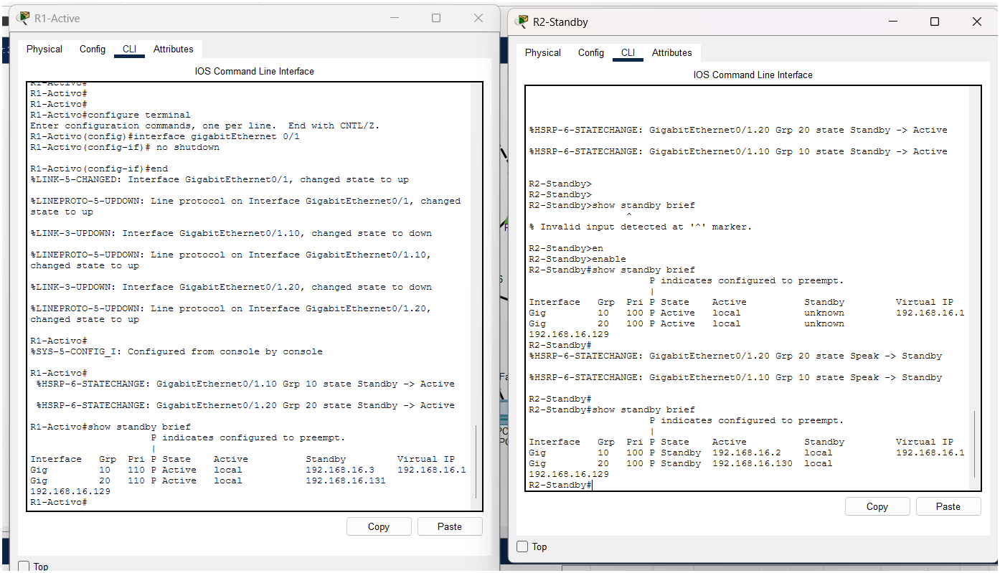

